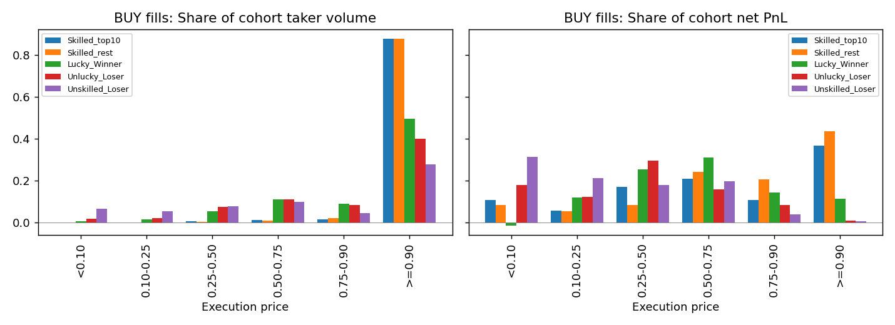
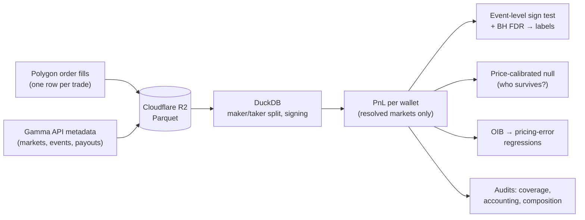

# Polymarket: crowd wisdom or informed minority?

A recent paper by Gómez-Cram, Guo, Jensen and Kung argues that Polymarket is accurate because
of a small group of skilled traders, about 3% of accounts, who see the news first and push
prices toward the truth. Everyone else supplies volume and pays for it.

This repo tests that claim on raw on-chain trade data: Polymarket order fills from
**Oct 5 – Nov 4, 2024** (255,566 wallets, $2.4B traded), plus **56 days in Aug–Oct 2026**
(243,074 taker wallets, $2.75B of taker volume). It rebuilds the paper's skill test from
scratch, then asks a harder question: when a wallet passes the test, *how* did it make its
money?

## What I found

1. **The paper's test does find a minority.** In 2024, 484 of 11,465 eligible traders (4.2%)
   win more consistently than chance allows, even after correcting for testing thousands of
   wallets at once. That is in line with the paper.
   → [Report 1](docs/reports/01_stage1_skill_test.md)

2. **Most of that "skill" is buying favorites.** The skilled group puts close to 90% of its buy
   volume into contracts priced at 90¢ or more. Those bets win almost every time, so a long
   winning streak looks impressive, but each one only pays a few cents. The original test treats a
   win and a loss as equally likely, so it cannot tell the difference. Rerun with a null that
   knows the price paid, **only 8 of the 484 survive**.
   → [Report 2](docs/reports/02_who_are_the_skilled.md)

3. **Buying favorites is not an edge.** Across all taker fills, favorites are about fairly
   priced, and a "buy the favorite in every market" rule earns about 0% at every horizon from 1
   hour to 7 days. The real mispricing is in longshots: bets under 10¢ lose 50–97% of the money
   put in, and that money goes to makers.
   → [Report 3](docs/reports/03_favorite_buying.md)

4. **The traders who really beat prices did it with speed, not secrets.** The handful of
   wallets that survive the strict test bought right after public news, traded live events
   faster than the market, or picked pregame NFL favorites. None of them looks like an insider.
   → [Report 2](docs/reports/02_who_are_the_skilled.md)

5. **Wallets with one big bet are mostly lucky election bettors.** Outside the election, a small
   group did trade ahead of the price (about +0.9¢ per share a day later), around discrete news
   such as the Ballon d'Or and Israel's strike on Iran. With so few bets, no single wallet can
   be proven skilled.
   → [Report 4](docs/reports/04_concentrated_winners.md)

6. **None of it carries over to 2026.** The same test flags 13.7% of recent traders, far too
   many to be an informed minority. Of the 484 skilled wallets from 2024, 4% traded at all in
   the first 2026 window, and 0.4% were flagged again.
   → [Reports 5](docs/reports/05_stage2_skill_test.md) and
   [6](docs/reports/06_stage2_vs_2024.md)

7. **Skilled trading does not measurably make prices more accurate here.** The paper's
   price-discovery regressions do not replicate. With execution prices standing in for quotes,
   every group's flow looks the same, which points to bid–ask bounce rather than information.
   → [Pipeline reference, Step K](docs/methods/pipeline.md#step-k--oib-and-pricing-error-regression)

**In one line:** a statistical "skilled minority" exists, but in this data it is mostly a
favorite-buying habit that the test rewards, not an informed group driving prices.



*Left: where each group's buy volume goes, by price paid. The two Skilled groups (blue and orange)
put about 88% of their volume at 90¢ or above. Right: where their profit comes from.*

## Reports

| # | Report | Question |
|---|---|---|
| 1 | [Is there a skilled minority?](docs/reports/01_stage1_skill_test.md) | Do some takers win more consistently than luck allows? |
| 2 | [Who are the skilled traders, really?](docs/reports/02_who_are_the_skilled.md) | Who still wins once the test accounts for the price paid, and how? |
| 3 | [Does buying favorites pay?](docs/reports/03_favorite_buying.md) | Can a taker profit by copying the favorite-buying pattern? |
| 4 | [Few bets, big wins](docs/reports/04_concentrated_winners.md) | What about wallets with one to three large, focused bets? |
| 5 | [Does it show up in 2026?](docs/reports/05_stage2_skill_test.md) | Does the skill test still find a minority in recent data? |
| 6 | [2026 vs 2024](docs/reports/06_stage2_vs_2024.md) | Do the 2024 winners keep winning? |

The [docs index](docs/README.md) has one-line answers, the methods docs, working notes, and a
glossary of the terms used throughout.

## How it works



- **Data.** 2024 fills were indexed from Polygon (through Goldsky, since retired) into R2 as
  Parquet. Recent history comes
  from the Hugging Face [`SII-WANGZJ/Polymarket_data`](https://huggingface.co/datasets/SII-WANGZJ/Polymarket_data)
  release; `scripts/validate_hf_sample.py` checks it row for row against the on-chain data.
  Market and event metadata comes from Polymarket's Gamma API.
- **Skill test.** For each taker, flip the sign of their PnL one event at a time and see how
  often a random flip beats the real result. Up to 12 events this is enumerated exactly; above
  that it uses 10,000 seeded draws. Benjamini–Hochberg then controls false discoveries.
- **Guardrails.** Only markets that resolved before the last fill count toward PnL. The first
  version of the analysis let the 2024 presidential market in early, and it alone was 60% of the
  volume. Every run also checks that maker PnL, taker PnL and fees net to zero, and that no
  p-value falls below the 2⁻ᴷ floor.

The full walk-through, with schemas and the reason for each step, is in the
[pipeline reference](docs/methods/pipeline.md).

## Running it

You need Python 3.11+, a free Cloudflare R2 bucket, and a Polygon RPC URL.

```bash
uv sync                      # or: pip install -e ".[dev]"
cp .env.example .env         # add R2 credentials and a Polygon RPC URL
python -m src.lib.duck --healthcheck
python -m src.data.load_markets
```

Then build PnL and run the skill test and its audits. The last step writes report 1:

```bash
export PNL_MARKET_UNIVERSE=resolved_by_fill_cutoff CLASSIFICATION_FDR_Q=0.05
python -m src.analysis.pnl
python -m src.analysis.sign_randomization
python -m src.analysis.classification
for step in partition coverage_audit sign_construct_audit multiple_testing \
            population_audit market_closure composition_audit trader_sanity stage1_gate; do
  python -m src.analysis.$step
done
```

The follow-up reports have their own modules (`skilled_profile`, `favorite_calibration`,
`concentrated_winners`), and `bash scripts/run_stage2_analysis.sh` runs the 2026 period.

[Setup and runbook](docs/methods/setup.md) covers credentials, every step, cost, and
troubleshooting. Tests run with `pytest`.

## Repo layout

```
src/
  data/       ingest: Gamma metadata, Hugging Face fills, ingest checks
  analysis/   PnL, sign test, classification, audits, regressions, report generators
  lib/        DuckDB/R2 connection, Polygon RPC, logging, checkpoints
scripts/      one-off analyses, backfill and Stage 2 runners
docs/
  reports/    the findings (start here)
  methods/    pipeline reference, setup, paper task list
  notes/      strategy and market-structure working notes
  figures/
notebooks/    exploratory notebooks
tests/
```

## Limitations

- **Short windows.** The 2024 sample is one month and is dominated by the US election, so
  dollar-weighted results lean on about 15 correlated election events.
- **No quote history.** Price-discovery tests use execution prices instead of the order book,
  which biases them toward bid–ask bounce. The paper had midpoint data.
- **Wallets are not people.** One trader can run several proxy wallets, and on-chain data alone
  cannot link them.
- **Fees changed.** Fees were near zero in 2024 but about 1% of volume in 2026, so the two
  periods are not fully comparable.

## Reference

Gómez-Cram, R., Guo, Y., Jensen, T. I., & Kung, H. (2026). *Prediction Market Accuracy: Crowd
Wisdom or Informed Minority?* The replication tasks taken from it are listed in
[docs/methods/paper_tasks.md](docs/methods/paper_tasks.md).

## License

[MIT](LICENSE)
