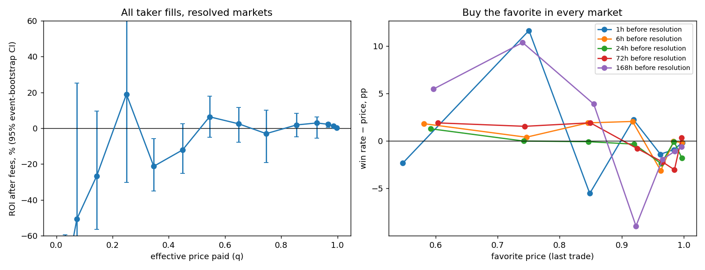

# Does buying favorites pay? (Oct–Nov 2024)

**Verdict: no, not as a taker.**

- Favorites at 90¢ and above are roughly fairly priced.
- A rule that buys the favorite in every market earns about 0% at every horizon tested.
- Weighted by dollars, favorite fills show +0.3% to +3%. That gain comes from a few high-volume
  markets where the favorite held, above all the election. Weighting each market once, favorite
  fills *underperform* their price.
- The mispricing is on the other side. Longshots under 10¢ lose 50–97% of the money put in. That
  money goes to whoever is **resting** favorite bids (makers), not to takers buying favorites.

"Skilled" wallets made money from favorites in three ways:

1. **The label selects on outcome.** The same strategy produced 1,550 "winners" and 3,451
   "losers"; the population nets about 0.
2. **This window favored favorites.** The dollar-weighted favorite premium explains 57% of
   Skilled favorite PnL.
3. **A small residual of real selection.** Buying in markets whose outcome was already public but
   not yet settled. Half of it belongs to one wallet, 0xfffe.

Code: `src/analysis/favorite_calibration.py`. Outputs: `logs/favorite_calibration/`.

**Universe:**
- 988,109 taker fills ($231M of effective cost) in 2,478 resolved markets and 748 events.
- Window: Oct 5 – Nov 4, 2024.
- Each fill is restated as "bought token X at effective price q". A SELL at p is a buy of the
  complement at 1−p.
- Resolution times come from Gamma `umaEndDate` / `closedTime` (100% coverage).
- Fees paid were $15 in total. A "2026 fee" column applies today's taker fee of 5%·q(1−q).
- 95% CIs come from an **event-cluster bootstrap** (1,000 draws), because markets in the same
  event are correlated.

## 1. Calibration of every taker fill

| Price paid | Fills | Markets | Win rate vs price | ROI after fees (95% CI) | ROI at 2026 fees | Excess, each market once |
|---|---|---|---|---|---|---|
| <2¢ | 129k | 1,961 | 0.01% vs 0.33% | **−96.5%** (−99.5, −86.4) | −101% | −0.36 pp |
| 2–5¢ | 31k | 850 | 0.5% vs 3.2% | **−85.3%** (−95.5, −59.4) | −90% | −1.2 pp |
| 5–10¢ | 34k | 1,145 | 3.6% vs 7.3% | −50.6% (−83, +25) | −55% | −1.9 pp |
| 40–50¢ | 48k | 1,361 | 39.5% vs 44.9% | −12.1% (−25, +2) | −15% | −9.0 pp |
| 80–90¢ | 69k | 1,589 | 87.1% vs 85.5% | +1.9% (−4.8, +8.3) | +1.2% | −0.2 pp |
| 90–95¢ | 68k | 1,530 | 95.3% vs 92.6% | +3.0% (−5.4, +6.2) | +2.6% | **−1.2 pp** |
| 95–98¢ | 70k | 1,431 | 98.8% vs 96.7% | **+2.2%** (+0.4, +3.0) | +2.1% | **−2.1 pp** |
| 98–99¢ | 38k | 1,212 | 99.8% vs 98.6% | **+1.3%** (+1.0, +1.4) | +1.2% | −1.3 pp |
| ≥99¢ | 193k | 1,855 | 99.99% vs 99.7% | **+0.26%** (+0.16, +0.39) | +0.24% | −0.7 pp |

The rows tell two different stories:

- **Weighted by dollars, it looks like a classic favorite–longshot bias.** But the gains are
  concentrated. All ≥90¢ fills by theme:
  - US election outcome: +2.2% (only 15 events, all correlated; Trump won).
  - Crypto, mostly the Trump-coin market: +0.9%.
  - Sports favorites: **−1.7%**.
  - Favorites bought live, after the listed end: **0.0%**.
- **Counting each market once, every bucket from 80¢ up underperforms its price.** In a typical
  market, favorite buyers do slightly worse than the price implies. The dollar-weighted profit
  comes from buying size where the outcome was effectively known.

## 2. Strategy test: buy the favorite in every market at horizon h

Rule: take the last trade before (resolution − h), buy whichever side is ≥50¢, and put equal
dollars in each market. This uses last-trade prices, not the ask, so it is **optimistic**.

| Horizon | Markets | ROI, all favorites | 90–95¢ | 95–98¢ | 98–99¢ | ≥99¢ |
|---|---|---|---|---|---|---|
| 1h | 2,425 | −0.3% | +2.4% (−8, +9) | −1.5% | −0.9% | −0.2% (−0.6, +0.1) |
| 6h | 2,359 | +1.3% | +2.2% | −3.3% | −0.1% | −0.2% |
| 24h | 1,831 | −0.1% | −0.4% | −2.5% | −0.1% | **−1.8%** (−3.7, −0.3) |
| 72h | 836 | +0.8% | −0.9% | −2.2% | −3.1% | +0.3% |
| 7d | 376 | +1.0% | −9.7% | −2.0% | −1.1% | −0.6% |

None of the totals differs from zero. The 95–99¢ cells are negative at every horizon, so there
is no "pennies in front of the steamroller" premium to harvest as a taker. One exception:
≥99¢ at 72h shows a statistically clear **+0.34%**, but that is 0.34¢ per share over about
3 days, before crossing the spread.

The upsets that sink favorites are information events:

| Upset | Favorite price | Losses on favorite fills |
|---|---|---|
| Vinícius Jr. to win the Ballon d'Or (Rodri won; reports that Real Madrid would skip the ceremony came out shortly before) | 92¢ | $135k |
| BTC above $62k on Oct 11 | 93¢ | $125k |
| Rodri *not* to win | 94¢ | $108k |
| Israel strikes Iran by Friday | 92¢ | $95k |
| Harris *not* on SNL | 95¢ | $94k |

## 3. How did "Skilled" make money?

**(a) The label is selection on outcome.**

- Among accounts with ≥80% of their cost at ≥90¢ and ≥5 positions, there are 7,975 "favorite
  specialists".
- Together they net **+$82k on $125M (+0.07%)**. Only 39% are profitable, and the median result
  is −$0.35.
- **441 of the 484 Skilled wallets are favorite specialists.**

| Label among favorite specialists | Accounts | Share profitable | Pooled ROI | Total PnL | Hit ≥1 favorite upset |
|---|---|---|---|---|---|
| Skilled_Winner | 441 | 100% | +1.3% | +$192k | **1.6%** |
| Lucky_Winner | 1,109 | 100% | +0.7% | +$475k | 11.8% |
| Unlucky_Loser | 2,602 | 0% | −1.3% | −$394k | 18.3% |
| Unskilled_Loser | 849 | 0% | −3.3% | −$162k | 5.3% |
| Excluded (too few trades) | 2,974 | 53% | −0.6% | −$30k | 8.7% |

It is the same strategy. The wallets that avoided an upset were labeled Skilled or Lucky; the ones
that hit one, or paid spread round-tripping, were labeled Unlucky or Unskilled.

The original sign-flip null treats a +5¢ win and a −5¢ loss as equally likely. On a 95¢ bet the
real loss is −95¢. Under that null, a streak of 20 favorite wins has p≈10⁻⁶; under fair pricing
it happens 36% of the time. The price-calibrated null corrects this, and only 8 of the 484
survive ([methods](../methods.md#price-calibrated-null)).

**(b) The window rewarded favorites.** Skilled earned $138.8k on ≥90¢ fills (0.95% ROI). If
other takers' ROI at the same price is applied (to the cent, excluding the Skilled group), the
expected PnL is **$78.6k (57%)**. That premium is the election-heavy, dollar-weighted effect from
section 1, which section 2 shows is not a repeatable rule.

**(c) The residual is small and concentrated.**

- Matching on price, time to resolution, theme and live/pre-event leaves **$56.7k**. Adding
  horizon, theme and the live flag barely shrinks it ($60k → $57k).
- **0xfffe alone is $29.4k.** The other 483 wallets share $27.3k: a median of $0.26 per wallet,
  with the top 5 holding 76%.
- 70% of Skilled favorite PnL comes from 10 markets.

| Market | Residual |
|---|---|
| Trump launch a coin | $12.8k |
| "Favorite to win on Polymarket day before election" | $12.8k |
| HBO documentary names Adam Back | $2.3k |
| Israel military action against Iraq | $2.2k |
| Another Iran strike on Israel in October | $1.4k |

These are markets whose **outcome was already public but not yet settled**. Time to resolution
cannot capture that information state, which is why the horizon control doesn't remove it. Per
the [survivor dossier](02_who_are_the_skilled.md), 87% of 0xfffe's passive fills there were
filled by takers buying the losing side for under 1¢.

## 4. Implications

- **Taker favorite carry doesn't pay.** At the market level the edge is zero or negative, before paying
  the ask and before 2026 fees (0.02–0.3¢ per share at q≥90¢).
- **The surviving idea sits on the maker side.** Rest bids at 98–99.5¢ in markets that are
  *decided but unsettled*, where longshot takers are the counterparty. That requires:
  1. A "decided" detector: news or official-source confirmation, plus UMA proposal state.
  2. Capacity estimates from historical longshot taker flow per market.
  3. Pricing UMA dispute risk.
  This is a different strategy from "buy favorites".
- **Avoid** sports favorites and information-event favorites (award leaks, surprise
  appearances, strike-timing markets). Those are where informed sellers hit favorite bids.

## Caveats

- One month of data, dominated by the election. Dollar-weighted results lean on about 15
  correlated election events.
- The horizon test uses last-trade prices, not executable asks; real taker results would be
  worse.
- Maker fills are excluded from calibration. Taker PnL is roughly the mirror of maker PnL, with
  fees close to zero in this window.
