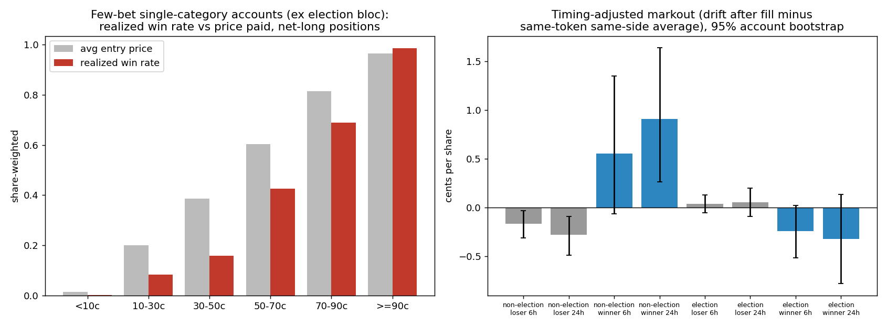

# Few bets, big wins: concentrated winners (Oct–Nov 2024)

This report examines accounts that the skill test in report 1 cannot see: wallets that made only a
few bets, all in one category, and won (or lost) a lot.

Data: Polymarket order fills from 2024-10-05 to 2024-11-04 (255,566 accounts, $2.4B). Unlike
the skill test, this report uses **every** market, including those that resolved after the data
ends, such as the 2024 presidential election. Each in-window position is scored at its final
resolution payout. Code: `python -m src.analysis.concentrated_winners`. Outputs are in
`logs/concentrated_winners/`.

---

## 1. Bottom line

1. **Most concentrated winners are election bettors.** 1,934 few-bet, single-category
   accounts made at least $1k, for $19.1M in total. 1,765 of them (91%), holding 96.5% of the
   money, bet on the US election outcome, almost always Trump at about 55–65¢. On the other
   side, 3,643 comparable accounts lost at least $1k, for −$34.9M in total. In the
   presidential-winner market, the 1,669 few-bet winners (+$17.2M) are outweighed by 2,854
   few-bet losers (−$23.6M). This is one coin flip seen from both sides. A single binary
   outcome cannot separate knowledge from luck, and the election winners' entries show **no**
   sign of being ahead of the market (Section 4).
2. **As a population, few-bet single-category accounts are uninformed.** Excluding the
   election bloc, their bets priced below 90¢ win far less often than the price implies.
   For example, 30–50¢ bets win 16% of the time against a 39% price, and the event-bootstrap
   CI excludes zero. Net PnL for the population is −$17.0M against a price-fair expectation
   of −$0.26M.
3. **A small non-election subset may have traded ahead of the price.**
   Concentrated winners' fills outside the election bloc (453 accounts) repriced in their
   favor more than the average same-side flow in the same token: **+0.9¢ per share at 24h
   (95% CI +0.25 to +1.7¢)**. The comparable losers show −0.3¢. The 169 winners whose main
   theme is not the election made +$671k in total. The effect is concentrated in a few
   discrete-news events, led by the **Ballon d'Or** (Rodri) and the **Israel strike on Iran**,
   and only about half of individual winners show it. Winners were picked for making money,
   which favors entries just before a repricing, so part of this markout is selection.
4. **No individual account can be certified.** With 1–3 bets, the best attainable
   price-calibrated p-value is about the product of the entry prices. 0 of 137,152 accounts
   survive multiple-testing correction. What can be done is in Section 6.

---

## 2. Who these accounts are

Selection (environment overridable): at most 3 events, at most 50 fills, at least 90% of
volume in one theme, and |PnL| of at least $1,000.

| Population | Accounts | Net resolution PnL |
|---|---:|---:|
| All accounts in window | 255,566 | — |
| Few-bet (≤3 events, ≤50 fills) | 160,143 | — |
| …and single-category (≥90% one theme) | **137,152** | **−$16.97M** |
| …of which US election outcome theme | 109,568 | −$15.76M |
| …of which every other theme | 27,584 | −$1.21M |
| Concentrated **winners** (PnL ≥ $1k) | 1,934 | +$19.15M (median $2.7k) |
| Concentrated **losers** (PnL ≤ −$1k) | 3,643 | −$34.94M |
| Non-election winners | 169 | +$0.67M (median $2.0k) |
| Non-election losers | 375 | −$1.38M |

**The skill test never sees them.** 88% of the winners (1,702) traded only markets that resolved
after the data ends, and 221 more failed eligibility (fewer than 10 trades or 5 events).
Only 9 carried a skill-test label, and those were Lucky_Winner.

**Winners by theme:**

| Main theme | Winners | PnL | Median |
|---|---:|---:|---:|
| US election outcome | 1,765 | $18.48M | $2.8k |
| Crypto | 40 | $0.20M | $2.4k |
| US campaign & politics props | 41 | $0.19M | $2.2k |
| Sports & esports | 43 | $0.15M | $1.8k |
| Geopolitics | 25 | $0.08M | $2.1k |
| Economy & markets | 14 | $0.04M | $1.7k |
| Other (3 themes) | 6 | $0.02M | — |

The largest winners all look the same: a single presidential-winner position of $0.1–2.0M
in 2–30 fills, for example `0x051b16ff…` with +$1.17M on $2.0M. Their ROI is 0.5–0.8,
which implies Trump entry prices of about 55–67¢, and their calibrated p-values are
0.55–0.68.

---

## 3. Mirror image: the same events from the losing side

Few-bet single-category accounts, by event:

| Event | Winners | Winner PnL | Losers | Loser PnL | Net, all few-bet accounts |
|---|---:|---:|---:|---:|---:|
| Presidential Election Winner 2024 | 1,669 | +$17.19M | 2,854 | −$23.57M | −$6.74M |
| Popular Vote Winner 2024 | 173 | +$0.85M | 744 | −$8.34M | −$7.68M |
| Trump wins every swing state? | 21 | +$0.09M | 45 | −$0.25M | −$0.18M |
| Ballon d'Or Winner | 16 | +$0.08M | 15 | −$0.05M | **+$0.02M** |
| Israel military response vs Iran by Friday? | 17 | +$0.05M | 12 | −$0.01M | **+$0.04M** |
| Who will HBO doc identify as Satoshi? | 12 | +$0.05M | 68 | −$0.16M | −$0.20M |
| Will Trump launch a coin before the election? | 19 | +$0.05M | 76 | −$0.17M | −$0.28M |
| League of Legends Worlds 2024 | 27 | +$0.04M | 28 | −$0.06M | −$0.02M |
| Fed Interest Rates: November 2024 | 18 | +$0.03M | 14 | −$0.02M | −$0.01M |

Few-bet single-category money lost overall on nearly every large event. The Ballon d'Or and
Israel–Iran are among the few where it came out ahead. In the election, it was mostly on the
losing side (Harris, popular vote).

---

## 4. Evidence that does not depend on who won

### 4.1 Calibration: do cheap bets win more often than their price?

These are net-long positions of the 137,152 few-bet single-category accounts, excluding
the election bloc (presidential winner, popular vote, winning party). Win rates and prices are
share-weighted. CIs come from a bootstrap over events, because outcomes are correlated within
an event.

| Entry price | Positions | Events | Avg price | Realized win rate | Edge per share (95% CI) |
|---|---:|---:|---:|---:|---|
| <10¢ | 12,955 | 512 | 1.5¢ | 0.1% | −1.4¢ (−2.2 to −1.0) |
| 10–30¢ | 5,748 | 430 | 19.9¢ | 8.4% | −11.5¢ (−18.3 to −0.8) |
| 30–50¢ | 5,786 | 454 | 38.6¢ | 15.9% | −22.8¢ (−29.7 to −8.2) |
| 50–70¢ | 7,406 | 472 | 60.3¢ | 42.6% | −17.7¢ (−32.7 to +3.6) |
| 70–90¢ | 4,935 | 434 | 81.5¢ | 69.0% | −12.5¢ (−37.2 to +8.7) |
| ≥90¢ | 39,348 | 597 | 96.5¢ | 98.5% | +2.0¢ (−0.2 to +3.6) |

This is the classic longshot / overconfidence pattern of one-shot retail bettors. As a group,
"few bets in one category" is a marker of **un**informed money. Any informed minority is a
small subset of this group.

### 4.2 Markouts: did prices move toward them after they traded?

For each fill, the *timing-adjusted markout* is the move in the token's hourly VWAP over the
next *h* hours, in the direction of the trade, minus the average move seen by all same-side
taker flow in that token over its life. Both terms condition on the same token, and therefore
on the same eventual outcome. A positive value means the trade came **ahead of repricing**,
not merely on the eventual winner. Values are cents per share, share-weighted, with 95% CIs
from a bootstrap over accounts.

| Group | Accounts | 6h | 24h | 72h |
|---|---:|---|---|---|
| Non-election winners | 453* | +0.55 (−0.05, +1.32) | **+0.91 (+0.25, +1.67)** | **+0.85 (+0.13, +1.66)** |
| Non-election losers | 1,047* | −0.16 (−0.31, −0.03) | −0.28 (−0.49, −0.09) | +0.15 (−0.27, +0.58) |
| Election-bloc winners | 1,722* | −0.24 (−0.53, +0.02) | −0.32 (−0.83, +0.12) | **−1.53 (−2.52, −0.48)** |
| Election-bloc losers | 3,182* | +0.04 (−0.05, +0.13) | +0.05 (−0.10, +0.21) | +0.26 (−0.05, +0.62) |

\*These counts are accounts with fills in that bloc. Some winners and losers traded both
blocs. As a reference, all taker flow in the same tokens has a raw markout of −0.03 to −0.07¢.

- **Election winners were not early.** They bought Trump before his late-October dip, and
  the market moved against them for days before the outcome rescued them. That is a correct
  view on a ~60% favorite, not information the market lacked.
- **Non-election winners were early**, but unevenly. Of the 169 winners whose main theme is
  not the election, 137 have measurable 24h markouts, and only 49% of those are
  individually positive. The average is driven by a handful of discrete-news
  episodes (Section 5).

### 4.3 Per-account significance

The price-calibrated null (each position pays 1 with probability equal to its entry price)
gives 14 winners at p<0.05, 6 of them outside the election, and **0 survivors** at BH q=0.05
across 137,152 accounts. With 1–3 bets this is a power limit, not evidence of no skill. The
smallest p any account can reach is roughly the product of its entry prices.

### 4.4 Linked wallets

Wallets that trade the same token on the same side within 60 seconds, on at least two
occasions, form 16 clusters covering 37 winners. Almost all are pairs in election markets,
which is weak evidence given how heavily those markets trade. The largest is 7 wallets
(+$7.9k), and two pairs made $227k and $128k. There is no sign of a large multi-wallet
syndicate among few-bet winners. Large known election whales trade more than 50 fills, so
this filter excludes them.

---

## 5. Case studies (non-election)

### 5.1 Ballon d'Or 2024: Rodri

The Rodri YES token traded at 5–10¢ through Oct 27 and briefly hit 19¢ around 23:00 UTC
that night. It then jumped from about 20¢ to **90¢ within the 14:00 UTC hour on Oct 28**,
when it became public that Vinícius Jr. would not win, several hours before the evening
ceremony.

| Wallet | Entry | Stake | Avg price | PnL | Calibrated p |
|---|---|---:|---:|---:|---:|
| `0x7477a09c…` | Oct 18–27 | $1.45k | 5.4¢ | +$25.3k | 0.006 |
| `0x1596c2e9…` | **Oct 28 11:23–13:36 UTC** | $1.56k | 14¢ | +$25.5k | 0.023 |
| `0xe677bf38…` | Oct 27 11:04–18:25 | $0.52k | 5.7¢ | +$8.9k | 0.054 |
| `0x0cebfb9b…`, `0x6b1cdeae…` | Oct 27–28 | $6–9k | 15–17¢ | +$4.4k, +$6.3k | 0.15–0.17 |

`0x1596` bought in the 2.5 hours **immediately before** the public repricing. Hourly
volume in the Rodri token rose from $0.4–0.6k (09:00–10:00) to $1.2–3.9k in the 11:00–13:00
hours while the price crept from 10¢ to 20¢. This is the clearest pre-news footprint in the
sample. The Ballon d'Or has the largest timing-adjusted markout of any event (+14¢ per share
at 24h). All of these wallets traded only this event.

### 5.2 Israel's strike on Iran (Oct 25–26)

In "Israel military response against Iran by Friday?", few-bet wallets bought YES at 8–20¢
during Friday Oct 25 UTC, hours before the strikes began that night:

- `0xcb18ea29…` bought from 10:55 to 22:03 at about 8¢ and made +$11.9k.
- `0x337392…` bought at 14:29 at 12¢ and made +$4.2k.
- `0xe1d9aa3c…` bought at 17:33 at 16¢ and made +$13.1k on $2.5k.
- `0xe12a32…` bought between 18:40 and 19:35 at 10¢ and made +$2.9k.
- `0x3075ed…` bought at 21:14 at 20¢ and made +$5.0k.

This is consistent with advance knowledge, but news of Israeli preparations was also public
that day, so it is weaker than the Ballon d'Or case. Several of these positions have no 24h
markout because the token stopped trading at resolution.

### 5.3 Other patterns

- **Live-event trading** (LoL Worlds final on Nov 2, Trump rally mentions, NFL games):
  wallets trade during the event at 40–75¢. This is the same play as the Skilled
  mention traders in the main report. It is fast public information, not private.
- **Election-correlated side bets** ("Trump wins every swing state?" at 20–30¢, "BTC $100k
  in 2024", "SOL ATH"): cheap tickets on outcomes driven by the same Trump win. They are
  not independent evidence.
- **HBO Satoshi documentary**: winners bought "someone else" (Peter Todd) at 54–66¢ in the
  two days before airing. Markouts are mixed to negative, so this is not distinguishable
  from a good read of public leaks.

### 5.4 Watchlist

`logs/concentrated_winners/watchlist_non_election.csv` ranks the 169 non-election winners
on three outcome-independent features: timing-adjusted 24h markout, cheapness of entry, and
calibrated p. The top entries are three Ballon d'Or wallets, two Israel–Iran wallets, and a
"Kamala on SNL" wallet that bought at 3.6¢ (+$5.5k).

---

## 6. Next steps

Outcome-based skill tests cannot work for one-shot bettors. The question has to change from
"is this account skilled?" to "**is this flow informed?**", tested on evidence that does not
depend on the outcome.

1. **Score flow, not accounts.** Flag fills that are (a) cheap (<30¢), (b) in
   discrete-news markets (awards, military action, announcements, appearances), (c) from
   wallets with few prior bets, and (d) larger than recent token volume. Then test **out of
   sample** whether flagged flow predicts repricing over the next 1–24h, using the
   timing-adjusted markout above. If it does, that is a tradable "follow informed flow" signal
   on Polymarket itself.
2. **Forward-track the watchlist.** Most one-shot wallets never trade again.
   Measure re-appearance, and whether returning wallets keep beating price in the same
   category.
3. **Extend history backward.** Pulling each wallet's pre-October-2024 fills (wallet age, past
   bets, past category) turns many "few-bet" accounts into multi-period records that the
   calibrated null can actually test.
4. **Link wallets by funding, not just timing.** Co-timing found only small clusters. On-chain
   USDC funding sources (shared deposit addresses) would catch split-wallet whales. This is
   not in the current dataset.
5. **Treat the election separately.** For single huge events, the only defensible test is
   timing against public information (markouts, entries before polls or news), not PnL.
   On that test, the few-bet Trump winners were not early.

---

## 7. Method notes and caveats

- **PnL** = (buy − sell shares) × payout − (buy − sell USDC) − fees, per account × token,
  taker plus maker, in-window fills only. Selling inventory bought before the window is scored
  as decision PnL, as if the account had held instead. A few top accounts with 0% buy share
  are such sellers.
- **Themes** come from `skilled_profile.classify_theme`. "Single-category" means at least 90%
  of volume in one theme.
- **Markouts** use hourly execution VWAP (no quotes) and forward-fill thin hours. Horizons past
  the data end (Nov 4) are dropped, which removes most election-day repricing.
- **Calibrated null**: positions in the same market are simulated jointly through the YES
  token, using 20,000 draws per account.
- Parameters: `CONC_MAX_EVENTS=3`, `CONC_MAX_FILLS=50`, `CONC_MIN_THEME_SHARE=0.9`,
  `CONC_MIN_PNL=1000`, `CONC_NULL_ITER=20000`. Set `CONC_REFRESH=1` to re-pull from R2.
- Artifacts: `accounts_all`, `few_bet_within_category`, `concentrated_{winners,losers,positions}`,
  `calibrated_null_few_within`, `selected_fills_markouts`, `token_hours` (`.parquet`);
  `event_symmetry`, `markouts`, `calibration_few_within_{all,ex_election}`, `winner_clusters`,
  `watchlist_non_election` (`.csv`); `summary.json`.
