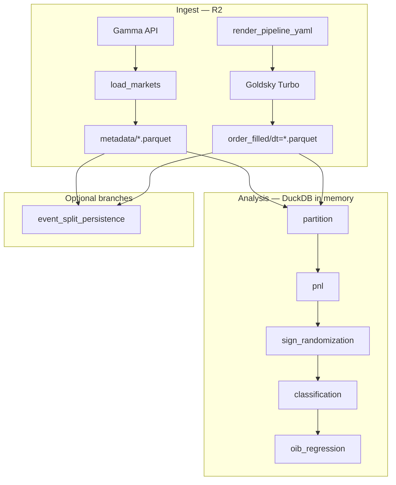
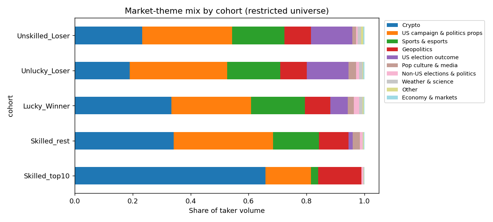

# v1 pipeline — full data and analysis view

End-to-end reference for the **Stage 1 informed-minority replication** (Oct–Dec 2024 sample). This document walks from **raw sources** through **every operation** to **OIB regression**, with schemas, observed shapes from a local run, and the **why** behind each step.

**Related docs:** [SETUP.md](SETUP.md) (runbook), [PROJECT_MEMORY.md](PROJECT_MEMORY.md) (status), [replication_reference_minority_paper.md](../replication_reference_minority_paper.md) (paper tasks).

> **Primary Stage 1 result (corrected 2026-10-04, v2):** Primary inference uses only
> markets whose market **and parent-event** end dates are on or before the fill cutoff
> (`resolved_by_cutoff_sql` in `src/analysis/event_grouping.py`). The first restricted run
> used the market end date alone and admitted the Harris 2024 winner market (market end
> 2024-11-04 12:00Z, event end 2024-11-05, real resolution 2024-11-06), which by itself was
> **60% of "restricted" volume**. Under the corrected universe, 87.8% of taker volume is
> attached to markets resolving after the cutoff. The primary cohort has 11,465 eligible
> traders, 914 nominal Skilled winners (7.97%, versus 539 expected under the discrete null,
> z=16.5), and **484 BH q=0.05 survivors**. Gate A and Gate B pass
> ([stage1_rigor_memo.md](stage1_rigor_memo.md)).
>
> **Main caveat (Section 5.8):** the event sign-flip null treats every position as a
> 50/50 bet. The FDR Skilled cohort puts 88% of its volume into buys priced ≥90¢. Under a
> price-calibrated null, where each position wins with probability equal to its entry
> price, only **8 of 484** FDR Skilled accounts survive BH q=0.05. Across the eligible
> cohort, 2.9% have calibrated p<0.05, which is below the 5% expected by chance. Gate A
> therefore shows that winning records are more consistent than coin flips, not that
> traders beat market prices. The earlier claim that "the two largest Skilled wallets are
> SELL flow" came from the leaked Harris market and is withdrawn. Corrected Skilled flow
> is 91% BUY.

---

## 0. High-level flow



**Storage layout on R2** (bucket from `R2_BUCKET`, default `polymarket-stage1`):

| Prefix | Writer | Role |
|--------|--------|------|
| `metadata/events.parquet` | `load_markets` | Gamma event spine |
| `metadata/markets.parquet` | `load_markets` | Markets + YES token + volume |
| `metadata/outcome_tokens.parquet` | `load_markets` | Token IDs, labels, resolved payout |
| `order_filled/dt=YYYY-MM-DD/*.parquet` | Goldsky | On-chain fills (filtered) |
| `derived/pnl_account.parquet` | `pnl` | Account-level taker PnL |
| `derived/pnl_user_asset.parquet` | `pnl` | User × asset PnL |
| `derived/sign_randomization_summary.parquet` | `sign_randomization` | Null-test stats per user |
| `labels/account_classification.parquet` | `classification` | Skilled / Lucky / … labels |
| `derived/sign_randomization_summary_event_{train,test}.parquet` | `event_split_persistence` | Paper Task 5 (optional) |
| `labels/account_classification_event_{train,test}.parquet` | `event_split_persistence` | Paper Task 5 (optional) |

Local **debug** artifacts (not on R2): `logs/<step>_*.jsonl`, `logs/<step>/*.parquet`, `logs/<step>/*.png`.

---

## 1. Data we load

### 1.1 Gamma metadata (API → R2)

**Script:** `python -m src.data.load_markets`  
**Source:** [`src/data/load_markets.py`](../src/data/load_markets.py)  
**API:** `GET {POLYMARKET_GAMMA_BASE_URL}/events` with `closed=true`, `end_date_min=2024-10-01`, `end_date_max=2024-12-31`.

**Why:** The paper needs **resolved** markets, **event_id** for correlated sign-randomization, **outcome token IDs** for Goldsky `asset IN (...)`, and **resolved_payout** for realized PnL. Gamma is the curated catalog; on-chain data alone does not provide event groupings or resolution labels in one place.

**Observed run** (`logs/load_markets_20260513T221908Z.jsonl`):

| Metric | Value |
|--------|------:|
| Raw event pages | 2,631 |
| `n_events` | 2,521 |
| `n_markets` | 6,445 |
| `n_outcome_tokens` | 12,890 |

#### Table: `metadata/events.parquet`

| Column | Type (logical) | Description |
|--------|----------------|-------------|
| `event_id` | string | Gamma event primary key |
| `slug` | string | URL slug |
| `title` | string | Human title |
| `end_date` | string (ISO) | Event end |
| `category` | string | From first tag slug/label |

**Shape:** `(2521, 5)` — one row per event in window.

**Sample row (conceptual):**

| event_id | slug | title | end_date | category |
|----------|------|-------|----------|----------|
| 903193 | presidential-election-winner-2024 | Presidential Election Winner 2024 | 2024-11-05T12:00:00Z | trump |

#### Table: `metadata/markets.parquet`

| Column | Description |
|--------|-------------|
| `market_id` | Gamma market / condition id |
| `event_id` | Parent event |
| `slug`, `question`, `end_date` | Metadata |
| `resolved_outcome_index` | Index of winning outcome in token list |
| `outcome_token_ids` | JSON array of CLOB token ids (string) |
| `volume` | Gamma-reported volume (USDC) |
| `yes_token_id` | Token id for YES side (for OIB yes-implied price) |

**Shape:** `(6445, 9)`.

**Sample row (conceptual):**

| market_id | event_id | question | volume | yes_token_id |
|-----------|----------|----------|-------:|--------------|
| … | 903193 | Will Trump win? | 1.2e9 | 78889442926505263… |

#### Table: `metadata/outcome_tokens.parquet`

| Column | Description |
|--------|-------------|
| `token_id` | Outcome token (decimal string, matches on-chain `asset`) |
| `market_id` | Parent market |
| `outcome_label` | e.g. Yes / No |
| `resolved_payout` | 1.0 if winner else 0.0 |

**Shape:** `(12890, 4)` — two tokens per binary market typical.

**Sample rows:**

| token_id | market_id | outcome_label | resolved_payout |
|----------|-----------|---------------|----------------:|
| 788894… | m1 | Yes | 1.0 |
| 136480… | m1 | No | 0.0 |

**QA from load:** payout sums per market ≈ 1; duplicate token check; category histogram in `logs/load_markets/`.

---

### 1.2 On-chain order fills (Goldsky → R2)

**Scripts:**

1. `python -m src.data.render_pipeline_yaml` — [`src/data/render_pipeline_yaml.py`](../src/data/render_pipeline_yaml.py)
2. `goldsky turbo apply goldsky/order_filled_backfill.rendered.yaml`
3. Optional: `python -m src.data.wait_for_backfill`, `python -m src.data.verify_ingest`

**Source dataset:** Goldsky `polymarket.order_filled` **v2.0.0** (Polygon), filtered at deploy time.

**Why:** Task 1.3 in the paper — transaction-level ledger with user, size, price, side, fees. Goldsky hosts the indexed chain data; we sink to R2 for DuckDB analytics without a warehouse.

**Render step (observed):**

| Setting | Value |
|---------|------:|
| `block_start` | 62,479,906 (≈ 2024-10-01 UTC) |
| `block_end` | 66,158,889 (≈ 2024-12-31 UTC) |
| Token filter count | 12,890 ids from `outcome_tokens.parquet` |
| Sink prefix | `order_filled/` |
| Partition column | `dt` (calendar date from `block_timestamp`) |

**Transform SQL (essential columns):** id, block_number, block_timestamp, transaction_hash, address, user_id, asset, amount_usdc, amount_shares, price, tx_type, side, order_hash, counterparty_id, **order_type** (maker/taker), fee, builder, **dt**.

**Why `asset IN (...)`:** Limits ingest to our Gamma universe and Goldsky cost; Turbo SQL cannot join external Parquet at runtime, so the list is baked into YAML at render time.

**R2 path pattern:**

```text
r2://$R2_BUCKET/order_filled/dt=2024-10-15/batch_*.parquet
```

**Hive partitioning:** DuckDB reads with `hive_partitioning = true`; virtual column `dt` from folder names.

#### Logical schema: `order_filled` (one row per fill)

| Column | Role |
|--------|------|
| `id` | Unique fill id (primary key in Goldsky transform) |
| `block_timestamp` | Unix seconds |
| `user_id` | Taker/maker wallet pseudonym |
| `asset` | Outcome token id |
| `amount_usdc`, `amount_shares`, `price` | Trade economics |
| `side` | BUY / SELL |
| `order_type` | **taker** vs **maker** (Task 2) |
| `fee` | Fee in USDC |
| `dt` | Partition date |

**Observed after analysis window filter** (`partition` run, ~30-day `ANALYSIS_USE_LAST_N_DAYS` style window):

| Metric | Value |
|--------|------:|
| `order_filled_rows` | 12,945,091 |
| `taker_rows` | 5,977,071 |
| `maker_rows` | 6,968,020 |
| `block_timestamp_min` | 1,727,740,800 |
| `block_timestamp_max` | 1,730,747,325 |
| Distinct taker users | 259,415 |

**Note:** Full Goldsky backfill to Dec 31 may be incomplete if Starter plan paused mid-run; analysis uses whatever is on R2, optionally clipped by `ANALYSIS_*` env vars.

**Verify ingest** (`python -m src.data.verify_ingest`, [`src/data/verify_ingest.py`](../src/data/verify_ingest.py)): row totals, daily counts, maker/taker split, Gamma vs on-chain volume ratio per market, orphan assets not in metadata.

---

### 1.3 Infrastructure helpers (not analysis tables)

| Script | Purpose |
|--------|---------|
| `python -m src.lib.duck --healthcheck` | R2 read/write probe |
| `python -m src.data.sync_goldsky_r2_secret` | Push R2 keys → Goldsky S3 secret |
| `python -m src.data.wait_for_backfill` | Poll until row count stable |

---

## 2. Analysis pipeline (post-R2)

All analysis modules use **DuckDB** ([`src/lib/duck.py`](../src/lib/duck.py)): in-memory DB, `httpfs` + R2 secret, reads `r2://` Parquet. Env loaded from repo-root `.env`.

**Optional analysis window** ([`src/analysis/partition.py`](../src/analysis/partition.py)):

- `ANALYSIS_BLOCK_TS_MIN` / `MAX` — inclusive Unix seconds on `block_timestamp`
- `ANALYSIS_USE_LAST_N_DAYS` — last N days from max timestamp in Parquet
- `MINORITY_LABEL_SPLIT=train_3w_test_1w` — PnL/sign/classify use `takers_train` (week_index 0–2); adds `week_index` column
- `OIB_EVAL_WEEK=all|train|test` — filter OIB fills by week bucket

---

### Step G — Partition (maker / taker views)

**Script:** `python -m src.analysis.partition`  
**Why (paper Task 2):** Skill analysis applies to **directional takers** only; makers are liquidity providers, not the informed-minority hypothesis target.

**Operation:** Registers DuckDB views over `read_parquet('r2://…/order_filled/**/*.parquet')`:

| View | Definition |
|------|------------|
| `order_filled` | All fills (+ `week_index` if window set) |
| `takers` | `lower(order_type) = 'taker'` |
| `takers_train` | `takers WHERE week_index < 3` |
| `makers` | `lower(order_type) = 'maker'` |

**`week_index` computation** (when a bounded analysis window is set):

```sql
week_index = LEAST(3, GREATEST(0,
    FLOOR((block_timestamp - anchor_ts) / 604800.0)::INTEGER
))
```

`anchor_ts` is `ANALYSIS_BLOCK_TS_MIN` by default (or the custom `ANALYSIS_WEEK_ANCHOR_TS` env var). The 604 800-second divisor is exactly 7 days. The formula assigns each fill to its calendar week within the analysis window:

| week_index | Offset from anchor | Role |
|------------|-------------------|------|
| 0 | [0, 7 days) | Training week 1 |
| 1 | [7, 14 days) | Training week 2 |
| 2 | [14, 21 days) | Training week 3 |
| 3 (**clamped**) | [21 days, …) | Test week for OIB |

Any fill beyond 3 weeks is clamped to `week_index = 3`; there is no `week_index = 4`. `takers_train` (`week_index < 3`) covers the first 21 days and is used for PnL labelling. `OIB_EVAL_WEEK=test` restricts `fills_enriched` to `week_index = 3`.

**Requires bounded window:** `MINORITY_LABEL_SPLIT=train_3w_test_1w` raises an error if neither `ANALYSIS_BLOCK_TS_MIN/MAX` nor `ANALYSIS_USE_LAST_N_DAYS` is set, because without a known window start there is no anchor for week offsets. Without a bounded window, every fill gets `week_index = 0`.

**Output:** Views only (no R2 write). Diagnostics: `logs/partition/takers_by_week_index.parquet`.

**Sample: takers by week_index** (when window enabled):

| week_index | c (rows) |
|------------|---------:|
| 0 | … |
| 1 | … |
| 2 | … |
| 3 | … (test week for OIB) |

---

### Step H — Realized PnL

**Script:** `python -m src.analysis.pnl`  
**Source:** [`src/analysis/pnl.py`](../src/analysis/pnl.py)  
**Why (paper Task 3.1):** Realized PnL vs resolution is the object for sign-randomization.

**Input view:** `takers` or `takers_train` (if minority split on).

**Logic:**

#### Step H.1 — Sign convention ("signing")

Each fill is transformed into a signed position delta before aggregation:

```sql
s_shares = CASE WHEN side='BUY' THEN +amount_shares ELSE -amount_shares END
s_usdc   = CASE WHEN side='BUY' THEN +amount_usdc   ELSE -amount_usdc   END
```

**`s_shares`** is the share-inventory delta: BUY fills increase the position; SELL fills decrease it.

**`s_usdc`** is the **cost-basis contribution**, not a cash receipt. A BUY trade costs USDC (you pay $60 for 100 shares), so it contributes `+amount_usdc` to the running USDC tally — your cumulative cash outlay grows. A SELL trade returns USDC (you receive $40 back), contributing `−amount_usdc` — your net cash invested shrinks. Thus `SUM(s_usdc)` = `cash_in` = net USDC deployed on this token. Positive `cash_in` means the user is a net buyer; negative `cash_in` means they recovered more than they spent (net seller / arbitrageur).

> **Potential confusion:** The sign rule "BUY → +shares, +USDC" does *not* mean buying gives you both more shares and more cash. The "+USDC" refers to the running cost-basis accumulator `cash_in`, not to cash arriving in your wallet. Think of it as: buying something makes both your inventory (+shares) and your tab (+USDC paid) go up.

#### Step H.2 — Per-(user, asset) PnL

Aggregated over all fills for a `(user_id, asset)` pair:

```
pnl = SUM(s_shares) × resolved_payout
    − SUM(s_usdc)
    − SUM(fee)
```

or equivalently:

```
pnl = net_position_value_at_resolution
    − net_cash_invested
    − total_fees_paid
```

- **`SUM(s_shares) × resolved_payout`**: Mark-to-resolution value of the net share position. `resolved_payout` is 1.0 for the winning token and 0.0 for the losing token. If the user holds a net long position and the token wins, this term equals the number of shares held; if the token loses, this term is zero.
- **`− SUM(s_usdc)`**: Subtract the total USDC the user net-deployed. For a pure buyer this is negative (a cost); for a user who net-sold this is positive (they got cash back, reducing outlay).
- **`− SUM(fee)`**: Subtract total fees paid across all fills.

**Worked examples:**

| Scenario | s_shares | s_usdc | resolved_payout | pnl |
|----------|:--------:|:------:|:---------------:|----:|
| Buy 100 shares @ $0.60, token wins | +100 | +60 | 1.0 | 100×1.0 − 60 − 0 = **+40** |
| Buy 100 shares @ $0.60, token loses | +100 | +60 | 0.0 | 100×0.0 − 60 − 0 = **−60** |
| Buy 100 @ $0.40, then sell 60 @ $0.55 (net long), token wins | +40 | +7 (net: 40−33) | 1.0 | 40×1.0 − 7 − 0 = **+33** |
| Pure seller: sell 100 @ $0.70 (no prior buy), token wins | −100 | −70 | 1.0 | −100×1.0 − (−70) − 0 = **−30** |
| Pure seller: sell 100 @ $0.70 (no prior buy), token loses | −100 | −70 | 0.0 | −100×0.0 − (−70) − 0 = **+70** |

**`position_shares` diagnostic:** `SUM(s_shares)` is saved as `position_shares` in `pnl_user_asset`. A market participant who fully traded in and out will have `position_shares ≈ 0`; non-zero values flag residual open inventory at resolution (still valid — shares are valued at `resolved_payout`). The QA assertion flags any `(user, asset)` pair with `|position_shares| > 1e-8`.

#### Step H.3 — Account roll-up

```sql
total_pnl = SUM(pnl)            -- across all (user_id, asset) pairs for this user
n_trades   = SUM(n_trades)
n_markets  = COUNT(DISTINCT market_id)
n_events   = COUNT(DISTINCT event_id)
```

Markets and events are counted via a join through `outcome_tokens → markets`. The `n_events` count here is used downstream for classifying users (minimum event requirement for sign randomization).

**Outputs on R2:**

#### `derived/pnl_user_asset.parquet`

| Column | Description |
|--------|-------------|
| `user_id`, `asset` | Keys |
| `pnl` | Realized PnL for that token |
| `position_shares`, `cash_in`, `fees`, `n_trades` | Diagnostics |

**Shape (observed):** ~1.27M rows with non-flat positions flagged in QA.

#### `derived/pnl_account.parquet`

| Column | Description |
|--------|-------------|
| `user_id` | Account |
| `total_pnl` | Sum of user_asset pnl |
| `n_trades`, `n_markets`, `n_events` | Activity |

**Shape (observed):** `(259415, 4)` accounts.

**Sample: PnL percentiles** (`logs/pnl/pnl_percentiles.parquet`):

| quantile | total_pnl |
|----------|----------:|
| 0.01 | −5342.75 |
| 0.50 | (median) |
| 0.99 | … |

**Sum of account PnL (observed):** ≈ −15.1M USDC (zero-sum-ish with fees).

---

### Step I — Event-level sign randomization

**Script:** `python -m src.analysis.sign_randomization`  
**Source:** [`src/analysis/sign_randomization.py`](../src/analysis/sign_randomization.py)  
**Why (paper Tasks 3.2–3.3):** Under null of no predictability, randomly flip **trade direction** (BUY↔SELL) at the **event** level — all fills by an account within an event flip together — while holding contract size, price, and fees fixed; recompute PnL per draw and compare to realized account PnL → p-values.

**Core:** `run_sign_randomization_core(ev_df, acct, rng, n_iter)`.

**Event matrix** (`load_event_pnl_matrix`):

```sql
SELECT p.user_id, m.event_id,
       SUM(p.pnl) AS event_pnl,
       SUM(p.fees) AS event_fees
FROM pnl_user_asset p
JOIN outcome_tokens ot ON token_id = p.asset
JOIN markets m ON m.market_id = ot.market_id
GROUP BY p.user_id, m.event_id
```

This collapses token-level PnL and fees up to event level. Fees do not flip when direction flips (always paid), so the null uses **pre-fee gross** per event: `event_gross = event_pnl + event_fees`.

**Observed:**

| Metric | Value |
|--------|------:|
| `n_event_pnl_rows` | 949,549 |
| Users with ≥2 events in sim | 153,261 (output rows) |
| `SIGN_RANDOMIZATION_ITERATIONS` | 10,000 |
| Wall time | ~843 s MC + overhead |

**Monte Carlo procedure (per user with ≥2 events):**

1. **Per-event inputs:** `event_gross_k = event_pnl_k + event_fees_k` (directional PnL before fees); `F = Σ_k event_fees_k` (total fees, fixed across draws).
2. **Random sign matrix:** `r_mat ∈ {−1, +1}^(n_iter × K)` — one independent sign per event, i.i.d. P(+1) = P(−1) = 0.5. Row `s` corresponds to flipping BUY↔SELL on **all** fills in events where `s_k = −1`.
3. **Null distribution:** `nulls = r_mat @ gross_vec − F`, shape `(n_iter,)`. Equivalently, for draw with signs `s_k`: account PnL = `Σ_k s_k × event_gross_k − F`. When all `s_k = +1`, this equals realized PnL. When `s_k = −1`, each event’s net shares and USDC cost basis are negated (opposite-direction counterfactual) while fees stay paid — not the same as `−event_pnl_k`.
4. **Realized PnL:** `realized = total_pnl` from `pnl_account` (actual directions).
5. **p-values:**
   - `p_skill = mean(nulls >= realized)` — fraction of random direction assignments achieving at least as high a PnL as observed.
   - `p_loss = mean(nulls <= realized)` — fraction doing at least as poorly.

**Why event-level (not per-fill)?** Paper: correlated bets within an event (multiple markets, position reversals) must flip together so the null preserves within-event structure and avoids bias from independent per-trade flips.

**QA — null mean check:** Under the null, `E[s_k × event_gross_k] = 0` per event, so `E[nulls] = −F` (not 0). The code flags `bad_null_mean` when `|null_mean − (−F)| > 0.01 × null_std`. At scale, occasional failures are finite-MC noise, not necessarily a broken RNG.

#### Output: `derived/sign_randomization_summary.parquet`

| Column | Description |
|--------|-------------|
| `user_id` | Account |
| `realized_pnl` | From `pnl_account` |
| `n_events_sim` | Events in arm |
| `n_trades` | Trade count |
| `null_mean`, `null_std` | Null distribution moments |
| `p_skill`, `p_loss` | Empirical p-values |
| `bad_null_mean` | QA flag |

**Shape:** `(153261, 9)` — users skipped if &lt; 2 events.

**Sample row (conceptual):**

| user_id | realized_pnl | n_events_sim | p_skill | p_loss |
|---------|-------------:|-------------:|--------:|-------:|
| 0xabc… | 1200.5 | 15 | 0.02 | 0.98 |

**QA:** `null_mean_zero` assertion often red at scale (tight threshold vs MC noise); p-values still usable.

---

### Step J — Classification

**Script:** `python -m src.analysis.classification`  
**Source:** [`src/analysis/classification.py`](../src/analysis/classification.py)  
**Why (paper Task 4):** Map p-values + PnL sign to **Skilled_Winner**, **Lucky_Winner**, **Unlucky_Loser**, **Unskilled_Loser**, **Excluded**.

**Rules** (`assign_group`):

| Priority | Condition | Label |
|----------|-----------|-------|
| 1 | `n_trades < 10` **or** `n_events_sim < 2` **or** `realized_pnl = 0` | **Excluded** |
| 2 | `realized_pnl > 0` **and** `p_skill < 0.05` | **Skilled_Winner** |
| 3 | `realized_pnl > 0` (else) | **Lucky_Winner** |
| 4 | `realized_pnl < 0` **and** `p_loss < 0.05` | **Unskilled_Loser** |
| 5 | `realized_pnl < 0` (else) | **Unlucky_Loser** |

**Exclusion criteria rationale:**
- `n_trades < 10`: Insufficient activity for reliable PnL signal; small sample sizes inflate noise in the sign-randomization p-values.
- `n_events_sim < 2`: Users with only 1 event have no variance in the null distribution (`c` is a scalar, so all flips give ±realized PnL with prob 0.5 each), making `p_skill` uninformative.
- Users absent from the sign-randomization output (traded in < 2 events) receive `n_events_sim = 0`, `p_skill = 1.0`, `p_loss = 1.0` (conservative fill) and are therefore Excluded by the `n_events_sim < 2` rule.

**p-value threshold:** The 5% (α = 0.05) threshold is one-tailed. `p_skill < 0.05` means fewer than 5% of random portfolios matched or exceeded the user's realized PnL, which is statistically significant under the sign-randomization null. No multiple-testing correction is applied at the classification stage (the paper discusses the FDR interpretation separately).

**Skilled share computation:**
```
skilled_share = n(Skilled_Winner) / n(non-Excluded)
```
Excluded accounts are removed from the denominator. The paper benchmark is ~3.14%; the green acceptance band used in QA assertions is 2–6%.

**Helper:** `build_classification_table(acct, sig)` left-joins `pnl_account` to `sign_randomization_summary` on `user_id`, fills missing sign-randomization rows with conservative defaults, then applies `assign_group` row-wise.

#### Output: `labels/account_classification.parquet`

| Column | Description |
|--------|-------------|
| `user_id`, `realized_pnl`, `n_trades`, `n_events` | From PnL |
| `n_events_sim`, `p_skill`, `p_loss` | From sign step |
| `trader_group` | Label |

**Observed group counts:**

| trader_group | n |
|--------------|--:|
| Excluded | 106,887 |
| Unlucky_Loser | 26,225 |
| Unskilled_Loser | 12,208 |
| Lucky_Winner | 13,189 |
| Skilled_Winner | **1,365** |

**Skilled share (non-excluded):** **2.58%** (paper ~3.14%; green band 2–6%). *Superseded:* these were unrestricted-universe, unadjusted weeks 0–2 labels.

**Current train-only labels (v2, used by OOS OIB and favorite attribution):**
`PNL_MARKET_UNIVERSE=resolved_by_fill_cutoff`, `MINORITY_LABEL_SPLIT=train_3w_test_1w`,
`CLASSIFICATION_FDR_Q=0.05`. With `CLASSIFICATION_FDR_Q` set, nominal Skilled accounts
that fail BH across the eligible cohort (`n_trades≥10`, `K≥5`) are demoted to
`Lucky_Winner`. The nominal label is kept in `trader_group_nominal`.

| trader_group | n |
|--------------|--:|
| Excluded | 34,455 |
| Unlucky_Loser | 2,520 |
| Lucky_Winner | 2,090 |
| Unskilled_Loser | 341 |
| Skilled_Winner (BH q=0.05) | **48** (357 nominal; 309 demoted) |

Only 39,454 accounts trade markets whose market and event end by the end of week 2, so
this cohort is thin. Skilled is 0.96% of classified accounts and 1.19% of the 4,037
eligible accounts. Five sign-randomization accounts trip the `null_mean_expected` 3×SE
check, against roughly 14 expected by chance among 5,003 tested accounts.

---

### Step K — OIB and pricing-error regression

**Script:** `python -m src.analysis.oib_regression`  
**Source:** [`src/analysis/oib_regression.py`](../src/analysis/oib_regression.py)  
**Why (paper Task 6):** Run two distinct price-discovery tests: whether directional **order imbalance (OIB)** predicts subsequent signed prices/outcomes, and whether the **volume share** of Skilled traders predicts reductions in lifecycle pricing error.

**Inputs:**

- `takers` (+ optional `OIB_EVAL_WEEK` filter)
- `labels/account_classification.parquet`
- `markets`, `outcome_tokens` views

**Pipeline inside `build_panel`:**

#### Step K.1 — `fills_enriched`: YES-implied price mapping

Each taker fill is joined to `markets` (via `outcome_tokens`) and `account_labels`. The fill's price is translated into a **YES-side implied price**:

```sql
yes_implied_price =
  CASE WHEN asset = yes_token_id THEN price
       ELSE (1.0 - price)
  END
```

**Rationale:** In a binary market, YES and NO token prices must sum to 1 under no-arbitrage (`p_yes + p_no = 1`). A fill on the NO token at price $0.35 implies a YES price of $0.65. Mapping all fills to a common YES-denominated price allows a single, consistent time series for every market regardless of which token was traded.

All fills in the bounded window form the price path and lifecycle clock. `OIB_EVAL_WEEK` filters only the flow used as regressors. Thus a test-week run does not stretch each market's test-week activity into an artificial complete lifecycle. When `OIB_EVAL_WEEK=test`, the script requires labels carrying `label_scope=train_weeks_0_2`; stale full-window labels now fail fast.

#### Step K.2 — Lifecycle binning

Per market, a **linear time grid** of 50 equal-width bins is constructed:

```sql
-- span table: one row per market
t0 = MIN(ts), t1 = MAX(ts) across all fills
-- only markets with t1 > t0 are retained

bin_id = LEAST(49, GREATEST(0,
    CAST(FLOOR((ts - t0) / (t1 - t0) * 50.0) AS INT)
))
```

- Bin 0 covers the very first fill in the market; bin 49 covers the very last.
- The **absolute calendar duration** of a bin varies by market (a liquid market active for 90 days has bins ~43 hours wide; a 1-day market has bins ~29 minutes wide). Normalising by market lifetime places all markets on a comparable [0, 1] lifecycle scale.
- Markets where `t0 = t1` (all fills at the same timestamp) are dropped by the `HAVING MAX(ts) > MIN(ts)` filter.
- The last fill of a market always lands exactly at bin 49 (the `LEAST(49, …)` clamp prevents an off-by-one creating a bin 50).

#### Step K.3 — Volume-weighted mid price (`mid_yes`)

Per `(market_id, bin_id)`:

```
mid_yes = Σ(yes_implied_price × amount_usdc) / Σ(amount_usdc)
```

A USDC-weighted average of YES-implied prices for all fills in the bin. Weighting by dollar volume rather than fill count gives more weight to larger trades, which better reflects the information content of each transaction.

#### Step K.4 — Absolute pricing error (`abs_err`)

```
abs_err = | mid_yes − yes_payout |
```

where `yes_payout ∈ {0.0, 1.0}` is the YES token's `resolved_payout` from `outcome_tokens`. This is the absolute distance between the current market mid-price (expressed in YES terms) and the eventual binary outcome — a direct measure of how mispriced the market is. A well-functioning market should show `abs_err` converging toward 0 as the event approaches resolution.

#### Step K.5 — Pricing error change (`d_err`)

The corrected implementation joins bin `b` to the exact future bins `b+1`, `b+5`, and `b+10`. It does not row-shift to the next observed trade bin, which could skip arbitrary lifecycle time. `d_err_hH = abs_err[b+H] − abs_err[b]`; negative values mean pricing improved.

#### Step K.6 — Order imbalance by group (`OIB_group`)

Per `(market_id, bin_id, trader_group)`:

```sql
oib_yes = (
    + YES buys − YES sells
    − NO buys  + NO sells
) / total bin volume
```

Range: `[−1, +1]`. Positive means the group is a net buyer of YES in that bin; negative means net seller of YES (or equivalently, net buyer of NO).

**Important details:**
- Both tokens enter the numerator. The old implementation discarded NO-token trades—**42.7% of volume** in the corrected test panel—which attenuated directional OIB.
- The denominator is **total bin volume** across all trader groups (not just the group's own volume), so `oib_yes` is naturally scaled by market activity and groups with similar flow at different activity levels are comparable.
- The `vol_share` column (`Σ amount_usdc_group / Σ amount_usdc_all`) captures the fraction of total volume attributable to the group in that bin, used as `volume_share_skilled` in the regression.
- Absolute-error models use outcome-aligned `AOIB = OIB × (2×yes_payout−1)`. Raw YES OIB cannot be pooled directly against absolute error because informed flow has opposite signs in YES- and NO-resolved markets.

After computing per-group OIBs, the table is pivoted (one column per group) and merged with the `mid_yes` / `abs_err` / `d_err` table to form the final regression panel.

**Superseded initial run (`OIB_EVAL_WEEK=test`, before the corrections below):**

| Metric | Value |
|--------|------:|
| `panel_rows` | 59,363 |
| `markets_in_panel` | 2,005 |
| `avg_bins_per_market` | 29.6 |
| `d_err_mean` | −0.0044 |

#### Panel sample (`logs/oib_regression/panel_head.parquet`)

**Current shape:** `(5000, 22)` diagnostic head. It includes exact-horizon price/error changes (`h1`, `h5`, `h10`), raw and outcome-aligned group OIBs, Skilled volume share, current midpoint, and resolved outcome.

| market_id | bin_id | d_err | OIB_skilled | OIB_unskilled | vol |
|-----------|-------:|------:|------------:|--------------:|----:|
| 240613 | 0 | −0.00007 | 0.0 | 0.0 | 2037 |
| 240613 | 1 | 0.00991 | 0.0 | 0.00170 | 8447 |
| 240613 | 2 | −0.00972 | 0.0 | 0.94164 | 191 |

#### Step K.7 — Regression (`run_regressions`)

**Corrected model families:**

1. `d_price_hH ~ raw OIB by group`: signed YES flow versus subsequent signed price changes.
2. `yes_payout ~ current mid_yes + raw OIB by group + bin FE`: incremental prediction of the final outcome.
3. `d_err_hH ~ outcome-aligned OIB by group`: directionally aligned accuracy change.
4. `d_err_hH ~ volume_share_skilled`: the paper's lifecycle informed-volume test.

For error models, a negative coefficient means improved accuracy. For signed-price models, a positive raw-OIB coefficient would mean YES buying precedes an increase in YES price.

**Fixed effects:**
- **Market FE** (`αₘ`): Absorbs all time-invariant market-level heterogeneity (e.g., market difficulty, baseline liquidity, category). Without market FE, coefficients could be confounded by systematic differences in which markets skilled traders prefer.
- **Bin FE** (`δᵦ`): Absorbs lifecycle trends common to all markets — e.g., prices generally converge toward resolution in later bins, and volatility may be higher in early bins regardless of trader composition.

**Standard errors:** Clustered by `market_id` to account for within-market serial autocorrelation across bins. Without clustering, the many consecutive (market, bin) observations would inflate precision estimates.

**Specs saved:** each model family has full two-way FE and one-way-FE robustness variants where identified. Standard errors are clustered by market.

**Superseded initial result (`regression_full_FE.parquet`):**

| term | param | stderr | tstat | pvalue |
|------|------:|-------:|------:|-------:|
| OIB_skilled | −0.00154 | 0.00203 | −0.76 | 0.448 |
| OIB_lucky | −0.00134 | 0.00121 | −1.11 | 0.268 |
| OIB_unlucky | −0.00451 | 0.00122 | −3.70 | **0.00022** |
| OIB_unskilled | −0.00621 | 0.00147 | −4.24 | **0.000022** |
| volume_share_skilled | −0.00215 | 0.00137 | −1.57 | 0.116 |

**R² (full FE):** ~0.001 (low R² normal with saturated FE; interpret coefficients, not R² alone).

**Scatter plots:** `logs/oib_regression/scatter_OIB_*.png`.

#### Current out-of-sample result (v2: restricted universe, train-only FDR labels)

Labels: the 48 train-only BH q=0.05 Skilled accounts above. Evaluation flow: test week
(`OIB_EVAL_WEEK=test`). `OIB_MARKET_UNIVERSE=resolved_by_fill_cutoff` restricts the panel to
markets whose market and event both end by the last fill, so terminal convergence is
observed. The `all` variant keeps every market as a sensitivity check.

| Panel | Rows | Markets | Skilled share of test flow | Markets ending after data |
|---|---:|---:|---:|---:|
| Resolved universe (primary) | 17,774 | 929 | 1.16% | 0% |
| All markets (sensitivity) | 29,899 | 1,898 | 0.12% | 50.2% |

Coefficients below are for the resolved universe, with full market and lifecycle-bin FE and SE clustered by market. The all-markets panel gives the same signs and significance.

| Test | Skilled β | p | Lucky β | Unlucky β | Unskilled β |
|---|---:|---:|---:|---:|---:|
| `d_err_h1 ~ volume_share_skilled` | +0.0214 | 0.128 | — | — | — |
| `d_err_h5 ~ volume_share_skilled` | +0.0514 | 0.093 | — | — | — |
| `d_err_h10 ~ volume_share_skilled` | +0.0314 | 0.278 | — | — | — |
| `d_err_h1 ~ AOIB` (outcome-aligned) | +0.0472 | 0.0003 | +0.0062 | +0.0150 | +0.0097 |
| `d_price_h1 ~ OIB` | −0.0190 | 0.175 | −0.0053 | −0.0153 | −0.0082 |
| `yes_payout ~ mid_yes + OIB + bin FE` | +0.0261 | 0.401 | −0.0146 | −0.0384 | +0.0240 |

**Interpretation.** The earlier volume-share result (β=−0.00673, p=0.0026) **does not
survive** the corrected labels and universe. The coefficient is now positive and
insignificant at every horizon. Outcome-aligned OIB coefficients are *positive* (error
rises) for every group, and raw OIB predicts *lower* next-bin prices for every group. That
pattern is the bid–ask bounce expected when VWAP execution prices stand in for quotes, not
a Skilled-specific effect. Skilled flow has no incremental power for the final outcome
beyond the current price. Given Section 5, this is unsurprising: the train-only Skilled
cohort buys contracts already priced near certainty, so its flow carries little
information beyond the prevailing price. The `terminal_gap ~ OIB_skilled` coefficient
(−0.22, p<1e-15) measures the same bin contemporaneously and is not evidence of
discovery.

#### Superseded: first corrected out-of-sample result (unrestricted universe, nominal labels)

Labels were rebuilt on weeks 0–2 only: 1,365 Skilled accounts, 2.58% of non-excluded accounts. Test-week flow then produced 40,612 panel rows across 2,017 markets. Skilled traders supplied 2.27% of test flow.

| Test (full market + lifecycle-bin FE) | Skilled coefficient | p-value | Interpretation |
|---|---:|---:|---|
| `d_err_h1 ~ volume_share_skilled` | **−0.00673** | **0.0026** | More Skilled activity predicts a 0.67 pp next-bin reduction in error |
| `d_err_h5 ~ volume_share_skilled` | −0.00812 | 0.0536 | Same direction over five bins; borderline |
| `d_err_h10 ~ volume_share_skilled` | −0.00288 | 0.587 | Effect is not detectable at ten bins |
| `d_price_h1 ~ OIB_skilled` | −0.00232 | 0.298 | No directional evidence at one bin |
| `d_price_h5 ~ OIB_skilled` | −0.00931 | 0.027 | Wrong sign for price impact |
| `yes_payout ~ mid_yes + OIB_skilled + bin FE` | 0.00501 | 0.611 | No incremental terminal-outcome prediction beyond price |

At the time, this run seemed to support the paper's **lifecycle volume-share channel**, but not directional OIB. The v2 rerun above does not reproduce it. The directional coefficients are negative for nearly every group, not uniquely Skilled, pointing to a measurement problem rather than a finding that Skilled flow moves prices backward. This repo lacks the paper's historical quote/midpoint series and uses execution-price VWAP. Buyer-initiated fills occur near the ask, mechanically making later transaction prices look lower (bid–ask bounce/endogeneity).

Power and horizon are also limited. The paper uses 2023–2025; this run has 30 days, with only one held-out week. Of 2,028 test-active markets, **987 (48.7%) end after the last ingested timestamp (2024-11-04)**, so the observed transaction path literally does not include the eventual convergence for almost half the markets. A longer R2 backfill plus historical midpoint/quote data is required for a paper-equivalent directional OIB test.

---

## 3. Optional branch — Event-split OOS persistence (paper Task 5)

**Script:** `python -m src.analysis.event_split_persistence`  
**Source:** [`src/analysis/event_split_persistence.py`](../src/analysis/event_split_persistence.py)

**Why:** Paper validates that **Skilled_Winner** labels **persist** on a **random holdout of events** (not calendar time). Separate from week-based OIB validation.

**Operation:**

1. **Collect events:** Query distinct `event_id` values from the join of `takers × outcome_tokens × markets` (only events that had actual taker activity in the analysis window).
2. **Random split:** Shuffle event IDs with `EVENT_OOS_SEED`; assign the first `floor(N × EVENT_OOS_TRAIN_FRAC)` events to train, the rest to test. The split is on **events** (not users or time), so a single user can appear in both arms if they traded events from both sets.
3. **Per-arm pipeline:** For each arm (`train`, `test`):
   - Create `takers_evt_{arm}` view: the `takers` view **inner-joined** to the arm's event ID list. This restricts the fills used for PnL and sign-randomization to only the arm's events — a user's PnL in each arm is computed from their trades in *those events only*.
   - Run `register_pnl_views → load_event_pnl_matrix → run_sign_randomization_core → build_classification_table` (using separate RNG seeds to keep arms independent).
   - Each arm uses a separate `sign_seed` (train: `SIGN_RANDOMIZATION_SEED`; test: `SIGN_RANDOMIZATION_SEED + 1_000_003`) to avoid identical random matrices.
4. **Transition matrix:** Inner-join train and test classifications on `user_id` (only users in both arms). Compute the cross-tabulation `P(test_group | train_group)`. The key statistic is:

```
P(Skilled_Winner_test | Skilled_Winner_train) = n(Skilled in both) / n(Skilled in train)
```

A rate substantially above the base rate (~2.5%) is evidence that the Skilled_Winner label is persistent across events rather than a sampling artefact. The train/test split is **orthogonal** to the calendar-week split: event split tests event-selection persistence; week split tests temporal out-of-sample performance.

**Current five-seed robustness (v2, `PNL_MARKET_UNIVERSE=resolved_by_fill_cutoff`, seeds 42–46, nominal p<0.05 labels in each arm):**

| Metric | Mean | SD | Min–max |
|---|---:|---:|---:|
| Classified in both arms | 1,772 | 318 | 1,520–2,270 |
| Train-Skilled and classifiable in test | 103 | 17 | 89–132 |
| `P(Skilled_test | Skilled_train)` | **14.36%** | 1.82 pp | 11.22–15.96% |
| Unconditional test Skilled base rate | 4.69% | 0.37 pp | 4.15–5.07% |
| Skilled persistence lift | **3.05×** | 0.25× | 2.71–3.31× |
| `P(test winner | Skilled_train)` | 58.37% | 8.08 pp | 47.96–65.96% |
| Unskilled persistence | 8.90% | 4.50 pp | 2.78–13.98% |
| Unskilled persistence lift | 1.82× | 0.77× | 0.66–2.57× |

Persistence survives the corrected universe, but at about 3× instead of 5×, and every
seed exceeds 2.7×. Unskilled persistence is now noisy: one seed falls below 1×. Event
splits test whether the *label* repeats on disjoint events. Section 5.8 shows that a
consistent favorite-buying habit would also repeat under the sign-flip null, so this
persistence measures behavioural stability, not necessarily information. An intermediate
run that used the market-end-only universe (with the Harris market leaked in) gave
16.5% versus 5.0% (3.32×). Its artifacts are in `logs/_sensitivity_market_end_universe/`.

**Superseded five-seed robustness (unrestricted universe):**

| Metric | Mean | SD | Min–max |
|---|---:|---:|---:|
| Classified in both arms | 5,007 | 1,302 | 3,871–7,207 |
| Train-Skilled and classifiable in test | 193 | 43 | 156–242 |
| `P(Skilled_test | Skilled_train)` | **14.46%** | 2.82 pp | 11.59–17.95% |
| Unconditional test Skilled base rate | 2.87% | 0.39 pp | 2.29–3.34% |
| Skilled persistence lift | **5.06×** | 0.90× | 4.14–6.32× |
| `P(test winner | Skilled_train)` | **54.15%** | 8.02 pp | 45.12–65.38% |
| Unskilled persistence | 44.35% | 11.05 pp | 31.09–54.79% |
| Unskilled persistence lift | 2.00× | 0.12× | 1.84–2.11× |

In that superseded run the Skilled result was also not seed-specific: every split produced at least 4.1× the test-arm Skilled base rate. The lower absolute persistence than 100% is expected because each test arm contains only 20% of events and the significance threshold is demanding. The monotone persistence of both skill and poor performance supports stable account differences, not merely one lucky event partition.

**Outputs (separate R2 keys, do not overwrite main pipeline):**

- `derived/sign_randomization_summary_event_train_seed{seed}.parquet` (when R2 export is enabled)
- `derived/sign_randomization_summary_event_test_seed{seed}.parquet`
- `labels/account_classification_event_{train,test}_seed{seed}.parquet`
- `logs/event_split_persistence/seed_{seed}/transition_counts.parquet`
- `logs/event_split_persistence/robustness_{by_seed,summary}.parquet`

**Env:** `EVENT_OOS_TRAIN_FRAC`, `EVENT_OOS_SEED`, `EVENT_OOS_SEEDS`, `EVENT_OOS_EXPORT_R2`; reuses `SIGN_RANDOMIZATION_*`.

---

## 4. Favorite-buying attribution

**Script:** `python -m src.analysis.favorite_buying`  
**Source:** [`src/analysis/favorite_buying.py`](../src/analysis/favorite_buying.py)

Each fill's settled contribution is computed additively as signed shares × payout − signed USDC − fee. BUY fills are split by their contemporaneous token price: favorite (`price ≥ threshold`) or underdog. Thresholds 0.50, 0.75, and 0.90 distinguish broad favorites from heavy favorites. `PNL_MARKET_UNIVERSE=resolved_by_fill_cutoff` restricts fills to markets whose market and event both end by the last fill. Without it, unresolved markets would be settled at a zero payout.

**Current result (v2: restricted universe, train-only BH q=0.05 labels).** Train means weeks 0–2 fills; test means week-3 fills with frozen train labels.

| Window/group | Accounts | Net PnL | ≥50¢ buys share of net | ≥75¢ | ≥90¢ | ≥90¢ share of BUY volume | Winners |
|---|---:|---:|---:|---:|---:|---:|---:|
| Train Skilled | 48 | +$25.9k | 80.3% | 46.9% | 32.0% | 94.7% | 44 (92%) |
| Train Lucky | 2,090 | +$1.70m | 64.9% | 27.8% | 7.1% | 54.3% | 1,697 (81%) |
| Train Unlucky | 2,520 | −$1.13m | 27.7% of losses | 11.8% | 2.0% | 52.1% | 204 (8%) |
| Train Unskilled | 341 | −$0.41m | 28.0% of losses | 3.8% | −2.2% | 50.5% | 13 (4%) |
| Test Skilled | 33 | +$4.5k | 64.0% | 38.6% | 113.9% | 93.8% | 20 (61%) |
| Test Lucky | 1,452 | +$67.9k | −76.4% | 70.9% | 119.7% | 60.3% | 660 (45%) |
| Test Unlucky | 1,447 | −$283k | 26.5% of losses | 10.2% | −6.6% | 58.7% | 603 (42%) |
| Test Unskilled | 199 | −$27.9k | −12.9% | 9.9% | −67.8% | 78.2% | 58 (29%) |

**Interpretation (reverses the superseded conclusion below).** Under the corrected labels and universe, Skilled accounts are overwhelmingly heavy-favorite buyers: 94–95% of their BUY volume is priced at 90¢ or more. In the train weeks, buys at 50¢ or more produce 80% of their net PnL, and buys at 90¢ or more produce 32%. In the held-out week, buys at 90¢ or more produce more than all of their (small) net PnL. Out of time, train-Skilled accounts still win more often: 61% of active accounts profit, against 45%, 42%, and 29% for the other groups. That ordering is monotone, but the dollar amount is only $4.5k across 33 accounts.

**Superseded result (unrestricted universe, nominal labels):**

| Window/group | Net PnL | PnL from ≥50¢ buys | Share of net PnL | PnL from ≥75¢ buys | Share of net PnL |
|---|---:|---:|---:|---:|---:|
| Train Skilled | $27.44m | $13.56m | 49.4% | $0.23m | 0.8% |
| Train Unskilled | −$8.99m | $2.42m | favorites offset losses | −$0.02m | 0.2% of losses |
| Test Skilled | $1.95m | $1.09m | 55.9% | $0.11m | 5.5% |
| Test Unskilled | −$0.83m | −$1.27m | 153.5% of net losses | −$0.01m | 1.0% of losses |

In that superseded run, ≥75¢ buys explained only 0.8% and 5.5% of Skilled PnL. Those PnL totals were dominated by markets that had not resolved within the data window, and the conclusion that "heavy favorites do not explain Skilled" does not hold in v2.

Artifacts: `logs/favorite_buying/summary_week-{train,test}.parquet` plus group-strategy and account-level tables.

---

## 5. Skilled-account analysis

**Script:** `python -m src.analysis.skilled_profile` (nominal variant:
`SKILLED_PROFILE_LABEL_COL=trader_group SKILLED_PROFILE_OUT_DIR=logs/skilled_profile_nominal`)  
**Source:** [`src/analysis/skilled_profile.py`](../src/analysis/skilled_profile.py)  
**Labels:** Stage 1 primary all-window labels with BH q=0.05 demotion
(`logs/multiple_testing/account_classification_primary_fdr.parquet`, column
`trader_group_fdr_q05`): 484 Skilled, 4,334 Lucky, 8,523 Unlucky, 1,928 Unskilled.  
**Data:** 1,814,430 taker and maker fills by classified accounts, restricted to markets
whose market and event end by the last fill. Profile taker PnL reconciles to label PnL
within 1e-9 USDC.

**Market themes.** Each market gets one theme from its Gamma event category plus a regex
on the event title and market question:

- **US election outcome:** winners, popular vote, state winners, chamber control, margins.
- **US campaign & politics props:** rallies, "What will Trump say", debates, VP picks, polls.
- **Crypto**, **Geopolitics**, **Sports & esports**, **Non-US elections**,
  **Pop culture & media**, **Economy & markets**, **Weather & science**.
- **Other:** 0.3% of volume.

**US election** means the first two themes combined.

**Definitions used below:**

- **Aligned volume:** BUY of the token that pays 1, or SELL of the token that pays 0.
- **Uncovered sell share:** the fraction of taker SELL shares not covered by the wallet's
  earlier in-window buys, whether taker or maker. Those shares must come from minting or
  pre-window inventory.
- **Hours to end:** the volume-weighted time between the fill and the market end date.

### 5.1 Volume and PnL

| Metric | Skilled | Lucky | Unlucky | Unskilled |
|---|---:|---:|---:|---:|
| Accounts | 484 | 4,334 | 8,523 | 1,928 |
| Taker volume | $16.45m | $56.01m | $40.91m | $4.49m |
| Net taker PnL | **+$376k** | +$3.25m | −$3.09m | −$0.92m |
| Share of all positive PnL | 10.4% | 89.6% | — | — |
| Aggregate ROI (PnL / volume) | 2.3% | 5.8% | −7.5% | −20.4% |
| Median account volume | $111 | $484 | $264 | $396 |
| Median account PnL | $1.59 | $29.98 | −$10.93 | −$6.89 |
| Median account ROI | 1.6% | 7.5% | −10.0% | −14.5% |
| Median fills / markets / events | 14 / 13 / 12 | 18 / 12 / 9 | 16 / 11 / 7 | 19 / 10 / 8 |
| Median average fill size | $7.09 | $21.87 | $13.32 | $18.33 |

Skilled accounts are small. 73% earned less than $10 and 92% less than $100 over the
window. Lucky winners earn 8.6× more in total and have a higher ROI. The Skilled label
selects for **consistency**, many small wins across many events, not for size or return.

### 5.2 Direction of trades

| Metric | Skilled | Lucky | Unlucky | Unskilled |
|---|---:|---:|---:|---:|
| BUY share of taker volume | **91.1%** | 77.1% | 70.5% | 61.5% |
| Median account BUY share | 100% | 82.5% | 76.3% | 65.1% |
| YES-token share of volume | 75.4% | 51.1% | 35.3% | 38.2% |
| Outcome-aligned share of volume | **90.9%** | 72.7% | 57.8% | 38.9% |
| Maker share of total (maker+taker) volume | 53.5% | 56.5% | 49.1% | 24.9% |
| Uncovered sell share | 3.9% | 64.0% | 14.6% | 10.3% |
| Volume-weighted hours to market end | 264 | 186 | 211 | 225 |

The earlier "Skilled = sell flow" description is wrong once the Harris market is
removed. Skilled takers almost only **buy** the side that later wins. Their few sells are
covered by earlier buys, so these accounts are not shorting via minting. They also post
maker orders for about half their volume, much like Lucky winners, so taker-only labels
miss half of their activity.

### 5.3 Price buckets


| BUY fills priced ≥90¢ | Skilled top 10 | Skilled rest | Lucky | Unlucky | Unskilled |
|---|---:|---:|---:|---:|---:|
| Share of cohort taker volume | 87.7% | 87.8% | 49.7% | 40.0% | 27.7% |
| Share of cohort net PnL | 36.6% | 43.7% | 11.3% | ~0% of losses | ~0% of losses |
| ROI | 1.0% | 0.7% | 1.3% | −0.2% | −0.4% |

Skilled accounts put about 88% of their volume into contracts that are nearly certain.
That carry earns a thin 0.7–1.0% and supplies 37–44% of their PnL. The remainder comes
from a sliver of cheaper buys: under 2% of volume at prices below 75¢ produces about half
of Skilled PnL, at 40–960% ROI. Unskilled losers are the mirror image. They put 6.5% of
volume into buys below 10¢ at a −98% ROI, which is long-shot buying. In the figure, PnL
shares for the loser cohorts are shares of a negative total.

### 5.4 Market categories



| Theme (share of taker volume) | Skilled top 10 | Skilled rest | Lucky | Unlucky | Unskilled |
|---|---:|---:|---:|---:|---:|
| Crypto | 65.9% | 34.2% | 33.4% | 19.0% | 23.3% |
| US campaign & politics props | 15.7% | 34.2% | 27.5% | 33.7% | 31.0% |
| Sports & esports | 2.4% | 16.0% | 18.7% | 18.3% | 18.1% |
| Geopolitics | 14.9% | 10.2% | 8.7% | 9.2% | 9.2% |
| US election outcome | 0.0% | 1.4% | 6.0% | 14.4% | 14.2% |
| All other themes | 1.1% | 4.0% | 5.7% | 5.4% | 4.2% |

Skilled accounts are the **least** election-heavy group. US-election markets are 18.1% of
their volume, against 33.5% (Lucky), 48.1% (Unlucky), and 45.2% (Unskilled). They make up
37.4% of Skilled PnL, almost entirely from campaign *props*. Skilled accounts hardly touch
election-outcome markets (1.4% of the rest's volume). The losing groups trade those about
2.4 times as heavily as Lucky winners. Theme ROI is thin for Skilled crypto (0.6%) and much
higher for top-10 props, geopolitics, and sports (5.5–12%).

### 5.5 Spread across categories and events

| Metric (median account) | Skilled | Lucky | Unlucky | Unskilled |
|---|---:|---:|---:|---:|
| Theme HHI (1 = single theme) | **0.29** | 0.65 | 0.63 | 0.64 |
| Number of themes traded | 6 | 3 | 2 | 3 |
| Largest event's share of absolute PnL | 36% | 40% | 51% | 35% |

The typical Skilled account spreads across about six themes, more than any other group.
That pattern fits a systematic rule like "buy whatever is nearly certain" better than
domain expertise. Event concentration is moderate, so typical Skilled PnL does not rest
on one event.

### 5.6 Correlation between Skilled accounts on the same markets and events

For each pair of accounts sharing at least three markets, we compute three quantities:

- **Agreement:** the share of shared markets where both wallets' net YES-direction flow
  has the same sign.
- **Expected agreement:** what agreement would be if the two accounts were independent,
  given each one's own hit rate. Two accounts that are each right 99% of the time agree
  about 98% of the time without any coordination.
- **Event PnL correlation:** the correlation of event-level PnL across events the pair
  shares, for pairs sharing at least five events.

The comparison groups are random samples of equally many eligible Lucky and Unlucky accounts.

| Pairs of… | Pairs | Mean agreement | Expected if independent | Excess | Median flow corr. | Median event-PnL corr. |
|---|---:|---:|---:|---:|---:|---:|
| Skilled (all 484) | 13,190 | 98.8% | 98.6% | +0.2 pp | 0.57 | 0.58 |
| Lucky sample | 6,859 | 52.2% | 51.3% | +0.9 pp | 0.08 | 0.02 |
| Unlucky sample | 5,341 | 58.5% | 51.8% | +6.7 pp | 0.19 | 0.11 |
| Within Skilled top 10 | 23 | 74.2% | 76.9% | −2.7 pp | 0.37 | −0.04 |

Skilled accounts almost always take the same side and their event PnLs are strongly
correlated. Both facts are explained by each account being right. There is **no excess
coordination** beyond that. The aggregate market-level signal is strong. In 1,567 markets
with Skilled flow, net Skilled flow points to the eventual outcome in 90.6% of markets
(99.5% volume-weighted, and 95.5% where at least three Skilled accounts trade). The
equivalent figures are 78.4% for Lucky, 60.2% for Unlucky, and 28.0% for Unskilled. But
Section 5.3 shows most of that flow is in contracts already priced near certainty.

**Linked-wallet screen.** A pair is flagged if it shares at least 10 markets, agrees at
least 90% of the time, and has at least 20 same-asset, same-side taker fills within 10
seconds of each other.

- **FDR Skilled cohort:** no pair is flagged. Twelve of 13,646 pairs have any co-timed
  fills, and none share a transaction. The most co-timed pair (`0x0362…`/`0x2139…`, 80
  fills) agrees on only 71% of 79 shared markets, against 63% expected.
- **Nominal 914-account cohort:** one cluster of four wallets is flagged (`0x58ca…`,
  `0x8e09…`, `0xd218…`, `0xd039…`). They share 93–229 markets and agree 97–100% of the
  time, against 61–67% expected. One pair has 505 co-timed fills. All four are 88–99% BUY,
  mostly sports and politics, with nominal p from 0.005 to 0.045, and all are FDR-demoted.
  This looks like one operator running several wallets, which breaks the
  independent-wallet assumption for these four nominal discoveries.

### 5.7 Top 10 Skilled accounts versus the rest

The top 10 FDR Skilled accounts by PnL earn **$348k, 92.4% of all Skilled PnL**, on $14.46m
(87.9%) of Skilled volume. The other 474 accounts share $28.7k. Their median PnL is $1.51,
the 90th percentile $37, the 99th percentile $1,115, and the maximum $6,095.

| Metric | Top 10 | Rest (474) |
|---|---:|---:|
| Net PnL / aggregate ROI | $348k / 2.4% | $28.7k / 1.4% |
| Median account volume / PnL | $287k / $26.3k | $110 / $1.51 |
| Median account ROI | 5.9% | 1.5% |
| Median fills / markets / events | 212 / 92 / 33 | 14 / 13 / 12 |
| Median average fill size | $1,237 | $7.04 |
| BUY share / outcome-aligned share | 91.1% / 91.0% | 91.0% / 90.8% |
| YES-token share | 80.8% | 36.6% |
| ≥90¢ BUY share of volume | 87.7% | 87.8% |
| US-election share of volume / PnL | 15.7% / 36.6% | 35.6% / 46.7% |
| Speech-mention markets (event title matches "What will … say"), share of volume / PnL | 8.6% / 29.1% | 16.3% / 31.3% |
| Median theme HHI / themes traded | 0.76 / 3 | 0.29 / 6 |
| Volume-weighted hours to market end | 286 | 106 |
| Maker share of volume | 54.1% | 48.5% |
| Price-calibrated p<0.05 (Section 5.8) | **8 of 10** | **4.9%** (≈ chance) |
| Survive BH q=0.05 under calibrated null | 3 | 5 |

| # | Wallet | PnL | Volume | ROI | Fills | Events | BUY | Main theme (share) | Mention-market PnL share | Hours to end | Sign-flip p | Calibrated p |
|---|---|---:|---:|---:|---:|---:|---:|---|---:|---:|---:|---:|
| 1 | `0x4dfd481c…` | $91.3k | $88k | 103% | 78 | 11 | 100% | Geopolitics (99%) | 0% | 106 | 0.0005 | 0.0004 |
| 2 | `0xfffe4013…` | $70.3k | $11.22m | 0.6% | 60 | 9 | 91% | Crypto (80%) | 0% | 337 | 0.0020 | **5e-6** |
| 3 | `0x03626d34…` | $45.4k | $678k | 6.7% | 688 | 71 | 88% | US props (72%) | 87% | 82 | 0.0001 | 0.0006 |
| 4 | `0xd1ecfa3e…` | $40.7k | $172k | 23.7% | 84 | 16 | 93% | Sports (99%) | 0% | 7 | 0.0002 | **0.0001** |
| 5 | `0x000d257d…` | $29.2k | $1.03m | 2.8% | 143 | 32 | 94% | Geopolitics (44%) | 0% | 239 | 0.0014 | 0.18 |
| 6 | `0xe75c5abf…` | $23.5k | $140k | 16.8% | 281 | 33 | 90% | US props (92%) | 100% | 8 | 0.0001 | 0.0008 |
| 7 | `0x2139ff88…` | $20.0k | $392k | 5.1% | 292 | 42 | 92% | US props (95%) | 100% | 21 | 0.0001 | 0.0074 |
| 8 | `0x45269642…` | $12.4k | $102k | 12.1% | 499 | 34 | 90% | US props (93%) | 95% | 12 | 0.0006 | **0.0001** |
| 9 | `0x6ffb4354…` | $8.1k | $460k | 1.8% | 657 | 149 | 100% | US props (60%) | 80% | 26 | 0.0001 | 0.0061 |
| 10 | `0xa7e4f9fa…` | $6.9k | $181k | 3.8% | 85 | 10 | 60% | Geopolitics (77%) | 0% | 114 | 0.0010 | 0.079 |

Bold calibrated p-values survive BH q=0.05 across all 11,465 eligible accounts.

**How the top 10 differ from the rest.**

1. **Scale.** The top 10 are about 2,600× larger by median volume, trade about 175× larger
   fills, and are active across about 7× more markets. The rest are micro-accounts.
2. **They are not simply favorite-buyers.** Both groups have the same ≥90¢ volume share.
   But 8 of the top 10 beat entry prices at p<0.05 under the calibrated null, while the
   rest do so at the 5% chance rate. The rest's Skilled label is explained by consistently
   buying near-certain contracts.
3. **Specialists rather than generalists.** The median top-10 account trades 3 themes with
   a theme HHI of 0.76. The rest spread across 6 themes with an HHI of 0.29. The top 10
   fall into three recognizable styles:
   - **Live speech-mention traders** (#3, #6, #7, #8, #9) earn 80–100% of their PnL from
     "What will Trump say during [rally]" markets. 84–100% of their PnL comes from fills
     after the listed end date (median about 11.5 hours after it, i.e. during the evening
     rally), so they are trading the live event (Section 5.9).
   - **Episode bettors** (#1, #10, and partly #5) made concentrated geopolitical calls. #1's
     PnL comes from Israel-military-response-to-Iran markets bought at 9–48¢, and it
     roughly doubled its money on that one late-October 2024 episode.
   - **Near-certainty carry** (#2) bought $7.9m of "Trump coin before the election?" (Yes)
     at 99.3¢ on Oct 16–17, after the WLFI token sale had already launched, plus similar 99¢
     contracts. That wallet is 78% of top-10 volume at a 0.6%
     ROI. Excluding it, the top 10 earn 8.6% on $3.24m.
4. **Not a coordinated group.** Within the top 10, agreement is 2.7 pp *below* the
   independence benchmark and event-PnL correlation is about zero. The rest correlate
   strongly with each other only because they buy the same near-certain sides.

### 5.8 Price-calibrated null (construct check)

The event sign-flip null (Steps I–J) assumes each event's PnL is equally likely to be
positive or negative. Suppose a wallet buys 95¢ contracts in 12 events and all resolve
Yes. Sign flipping scores that at p=2^-12=0.0002, but a trader with no skill would get the
same record with probability 0.95^12≈54%.

`_calibrated_null` tests the economically relevant null, that the account does not beat
its own entry prices. Each net token position pays 1 with probability equal to its
average entry price, so expected PnL is zero. Each account gets 5,000 draws, refined to
200,000 when p<0.01, with p=(1+exceedances)/(1+draws). Positions are drawn independently,
and paying the spread makes the null slightly conservative, so treat this as a diagnostic
rather than an exact test.

| Cohort (eligible, K≥5) | Accounts | Calibrated p<0.05 | Survive BH q=0.05 |
|---|---:|---:|---:|
| Skilled top 10 | 10 | 80% | 3 |
| Skilled rest | 474 | 4.9% | 5 |
| Lucky | 3,524 | 7.4% | 27 |
| Unlucky | 5,529 | 0.7% | 4 |
| Unskilled | 1,928 | 0.1% | 0 |
| **All eligible** | **11,465** | **2.9%** | **39** |

Across the cohort, the share of accounts with calibrated p<0.05 (2.9%) is *below* the 5%
expected by chance. There is no population-level evidence of beating market prices. Only
8 of 484 FDR Skilled accounts survive calibrated BH. Those 8 hold $124k, 33% of Skilled
PnL, and include top-10 #2, #4, and #8. Calibrated survivors are spread across groups.
Twenty-seven are Lucky winners whose sign-flip p-values missed BH, often accounts with
only 5–9 events that bought underdogs and won. Four
Unlucky survivors with near-zero PnL show the diagnostic's limitation for round-trip
positions. In the nominal 914-account cohort, 16.4% reach calibrated p<0.05 and 24
survive BH. Artifacts: `calibrated_null_accounts.parquet` and
`calibrated_null_summary.parquet`.

**Bottom line for Stage 1.** The Skilled label in this sample mostly identifies
*systematic heavy-favorite buyers*, wallets that win small amounts consistently. It does
not identify an informed minority. A handful of accounts, about 8 to 39 depending on
definition, beat entry prices at the multiple-testing level. They are concentrated in live
mention markets, single geopolitical episodes, and near-certain carry. Any Stage 3/4 use of
"Skilled" identity should first replace or augment the sign-flip null with a price-aware
one.

**Artifacts (`logs/skilled_profile/`):** `group_summary`, `cohort_summary`,
`theme_by_{group,cohort}`, `direction_by_{group,cohort}`, `price_by_{group,cohort}`,
`consensus_by_group`, `pair_summary`, `pair_summary_top`, `skilled_pairs`,
`linked_wallet_candidates`, `top_skilled`, `accounts`, and `calibrated_null_*` (all
`.parquet`), plus `summary.json` and two PNGs, which are copied to `docs/figures/`.

### 5.9 Where the Skilled money comes from (playbook decomposition)

`python -m src.analysis.skilled_playbook` (outputs in `logs/skilled_playbook/`) splits every
Skilled taker fill by *effective* entry price (a SELL at p backs the other side at 1−p) and
by timing relative to the market's listed end date. PnL per fill is Σ shares × (won −
price), so a band is profitable exactly when its share-weighted win rate beats its
share-weighted price.

| Effective price band | Top 10 PnL (share) | Top 10 win rate vs price | Rest PnL (share) | Rest win rate vs price | Volume share (top 10 / rest) |
|---|---:|---|---:|---|---|
| Longshot <20¢ | $42.8k (12%) | 4.7% vs 1.7% | $1.6k (5%) | 2.5% vs 1.7% | 9% / 9% |
| Underdog 20–50¢ | $59.2k (17%) | 68% vs 38% | $1.7k (6%) | 42% vs 34% | 1% / 1% |
| Favorite 50–80¢ | $89.5k (26%) | 94% vs 68% | $8.2k (29%) | 85% vs 65% | 2% / 1% |
| Strong favorite 80–95¢ | $49.4k (14%) | 98% vs 89% | $8.6k (30%) | 99% vs 89% | 3% / 4% |
| Near-certain ≥95¢ | $106.8k (31%) | 100% vs 99.1% | $8.5k (30%) | 99.9% vs 99.4% | 86% / 86% |

| Timing of fill | Top 10 PnL (share) | Rest PnL (share) |
|---|---:|---:|
| After the listed end date (live event) | $123.9k (36%) | $14.9k (52%) |
| Less than 24h before end | $39.7k (11%) | $4.5k (16%) |
| 1–7 days before | $115.0k (33%) | $4.8k (17%) |
| More than 7 days before | $69.2k (20%) | $4.5k (16%) |

"After the listed end date" fills have a median lag of 11.5 hours, which lands in the evening
of the event day. They are dominated by Trump-rally mention markets ("Will Trump say 'China'
10+ times…") and live NFL/college games. In other words, they are **live in-event trading**,
not stale settlement.

**What the Skilled accounts do, and what each play earns ($376k in total):**

1. **Live-event trading, $139k (37%).** Wallets watch the rally or game and buy outcomes as
   they become clear, usually at 55–90¢. Five of the top 10 (#3, #6, #7, #8, #9) earn
   84–100% of their PnL this way.
2. **Episode calls on underdogs and favorites, about $150k (40%).** These are concentrated
   bets at 9–80¢ on single geopolitical, sports, or crypto episodes. Examples are #1's
   Israel–Iran markets ($81k from fills below 50¢) and #4's sports favorites ($28k at
   50–80¢). Here the win rate beats the price by 25–30 points.
3. **Near-certainty carry, about $115k (31%).** This is buying at 95¢ or more, mostly #2
   ($76k on $11.2m of volume at 0.6–0.9% ROI). It uses 86% of Skilled volume for under a
   third of the PnL.
4. **The 474 non-top-10 accounts** are mostly micro carry. 298 of them get most of their
   positive PnL from ≥95¢ buys (median $1.10 each). Only 65 are mainly favorite buyers at
   50–80¢ (median $9).

These categories overlap: a live-event fill can also be a favorite buy. The shares therefore
sum to more than 100%.

### 5.10 Do Skilled crypto bets predict coin prices? (copy-trade backtest)

**Question.** Can we copy Skilled accounts' bets on crypto *price* markets ("Bitcoin above
$68k on Nov 1?", "Will Solana dip to $130 in October?") as long/short positions in
BTC/ETH/SOL on an exchange?

**Script.** `scripts/crypto_signal_backtest.py`, run in the `pm-backtest` conda env. It uses
Coinbase 5-minute bars via ccxt; yfinance only has daily bars for Oct–Nov 2024 because its
intraday history is limited to 730 days. Each fill is mapped to a direction on the coin:
YES on "above" is long, and touch markets are up-barrier if the strike is above the open at
window start. Fills are bucketed per (cohort, market, 5-minute window). A bucket with at
least $100 of net directional flow opens a position at the next bar open. Exits are either at
the market end time or after 24 hours. The portfolio is equal-weight across open positions
with gross exposure at most 1×. Costs are 12 bps per side plus 1 bp per 8 hours of perp funding.

**Key filter.** A fill is dropped as *already determined* if the touch barrier had already
been hit, or if the fill came after the market end time. That covers **95%** of the top 10's
price-market USDC and 56% of all Skilled USDC. These are near-certainty carry bets at
99¢ or more, not forecasts.

| Cohort (exit at resolution) | Trades | Hit rate (net) | Mean gross/trade | Total return | Sharpe | Max DD |
|---|---|---|---|---|---|---|
| Skilled top 10 | 1 | 1/1 | +4.8% | +4.4% | n/a (1 trade) | −0.9% |
| All Skilled (FDR) | 36 | 39% | +0.21% | −10.3% | −3.8 | −10.4% |
| Lucky_Winner | 1,581 | 29% | +0.01% | −29.5% | −7.5 | −30.3% |
| Unskilled_Loser | 135 | 43% | −0.18% | −6.5% | −4.0 | −9.4% |
| BTC buy-and-hold (same window) | — | — | — | about +54–59% | about 6.4 | −7.2% |

With 24-hour exits the results are similar. All Skilled lose 15.5% with a Sharpe of −4.8,
and the top 10 have the same single trade. The naive run, which keeps already-determined
fills (`CRYPTO_BT_KEEP_DETERMINED=1`), gives the top 10 +7.3% with a Sharpe of 2.4 on
4 trades. All four were longs into the late-October BTC rally, entered after the barriers
had already been hit. That is market beta, not information.

**Answer.** No. The top 10 have a single real directional crypto bet (one account long BTC on
Oct 28), so no Sharpe can be estimated from them. The broader Skilled cohort's
gross edge is indistinguishable from zero (t ≈ 0.2) and negative after costs. Every
cohort trails BTC buy-and-hold. Outputs are in `logs/crypto_backtest/`: `summary.csv`,
`trades.csv`, `daily_returns.csv`, and QuantStats `tearsheet_*.html` and `snapshot_*.png`.

---

## 6. Paper task mapping

| Paper task | Repo step | Script |
|------------|-----------|--------|
| 1 Data assembly | Gamma + Goldsky → R2 | `load_markets`, `render_pipeline_yaml`, Goldsky apply |
| 2 Maker vs taker | Partition views | `partition` |
| 3 Sign randomization | Event-level MC | `sign_randomization` |
| 4 Classification | Four groups + Skilled | `classification` |
| 5 OOS persistence | Event split | `event_split_persistence` |
| 6 OIB / pricing error | Panel + PanelOLS | `oib_regression` |
| 7 Event studies | Not implemented | — |

---

## 7. End-to-end command sequence

**Pre-R2:**

```bash
python -m src.data.load_markets
python -m src.data.render_pipeline_yaml
goldsky turbo apply goldsky/order_filled_backfill.rendered.yaml
python -m src.data.verify_ingest
```

**Post-R2 (set `.env` — e.g. `ANALYSIS_USE_LAST_N_DAYS=30`, `MINORITY_LABEL_SPLIT=train_3w_test_1w`):**

```bash
python -m src.analysis.pnl
python -m src.analysis.sign_randomization
python -m src.analysis.classification
OIB_EVAL_WEEK=test python -m src.analysis.oib_regression
```

**Current v2 downstream sequence (restricted universe, train-only FDR labels):**

```bash
export PNL_MARKET_UNIVERSE=resolved_by_fill_cutoff CLASSIFICATION_FDR_Q=0.05
python -m src.analysis.sign_randomization
python -m src.analysis.classification
OIB_EVAL_WEEK=test OIB_MARKET_UNIVERSE=resolved_by_fill_cutoff python -m src.analysis.oib_regression
OIB_EVAL_WEEK=test OIB_MARKET_UNIVERSE=all python -m src.analysis.oib_regression   # sensitivity
FAVORITE_ANALYSIS_WEEK=train python -m src.analysis.favorite_buying
FAVORITE_ANALYSIS_WEEK=test python -m src.analysis.favorite_buying
EVENT_OOS_SEEDS=42,43,44,45,46 python -m src.analysis.event_split_robustness
```

**Skilled-account analysis (after the Stage 1 sequence in SETUP Step J2):**

```bash
SKILLED_PROFILE_REFRESH=1 python -m src.analysis.skilled_profile
SKILLED_PROFILE_LABEL_COL=trader_group SKILLED_PROFILE_OUT_DIR=logs/skilled_profile_nominal \
  python -m src.analysis.skilled_profile
python scripts/oib_table.py logs/oib_regression   # print all OIB coefficients
```

`SKILLED_PROFILE_REFRESH=1` rebuilds the local fill cache (`logs/skilled_profile/fills_cache.parquet`); set it whenever labels or the universe change.

**Notebook:** [`notebooks/stage1.ipynb`](../notebooks/stage1.ipynb) — Pre-R2 vs Post-R2 cells + plots.

---

## 8. Debug and reproducibility

Every module wraps work in `debug_step(...)` ([`src/lib/debug.py`](../src/lib/debug.py)):

- **JSONL:** `logs/<step>_<timestamp>.jsonl` — metrics + green/yellow/red assertions
- **Parquet/JSON:** `logs/<step>/` — sample tables, histograms, regression coefficients
- **PNG:** null histograms, OIB scatters

To reload a regression table in DuckDB:

```sql
SELECT * FROM read_parquet('logs/oib_regression/regression_full_FE.parquet');
```

---

## 9. Known limitations (v1)

- **Sign-flip null is price-blind.** It treats every event as a 50/50 bet, so consistent
  heavy-favorite buying becomes "significant". See Section 5.8. A price-aware null is
  needed before Skilled identity is used in Stage 3/4.
- **Gamma end dates are scheduled, not actual resolution.** The universe now requires
  market and event end dates by the cutoff. Markets that resolve late despite early
  scheduled ends can still slip through.
- **Taker-only labels.** Skilled and Lucky wallets route about half of their volume as
  makers, and that flow is not used for classification.
- **Ingest may be partial** (Goldsky Starter pause); `block_end` in YAML can exceed actual `ts_max` on R2.
- **Median markets per event = 1** in Gamma window — event-level randomization still valid but clusters are often single-market events.
- **Week split vs event split** answer different validation questions; both can be enabled with care (event split uses full `takers` window, not `takers_train`).
- **Historical prices time series** (paper Task 1.2) not ingested; mid prices come from fill prices in OIB step.
- **Task 7 event studies** not implemented.

---

*Document version: v1 — shapes and metrics from local runs 2026-05-13/15 unless noted as conceptual samples. v2 results (corrected universe, FDR labels, Section 5) are from 2026-10-04 runs. Pre-correction artifacts are under `logs/_archive_pre_stage1/` and `logs/_sensitivity_market_end_universe/`.*
